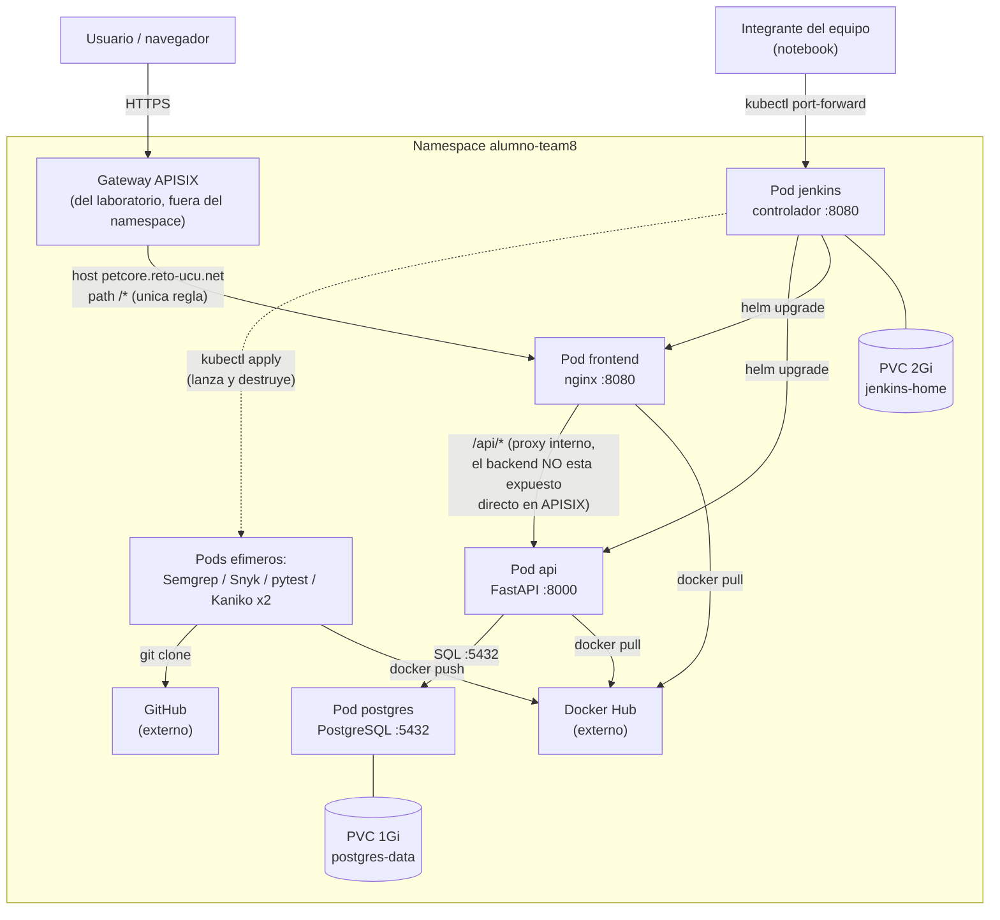
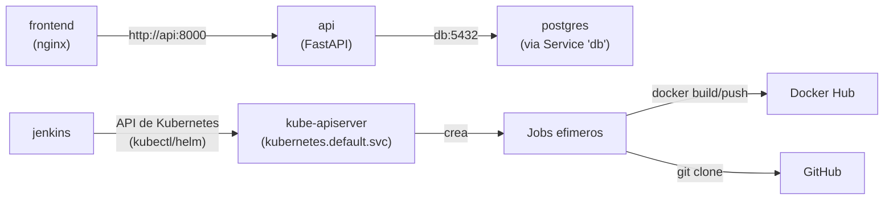
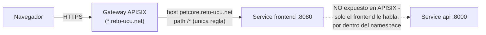
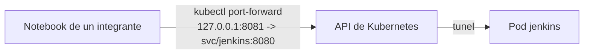
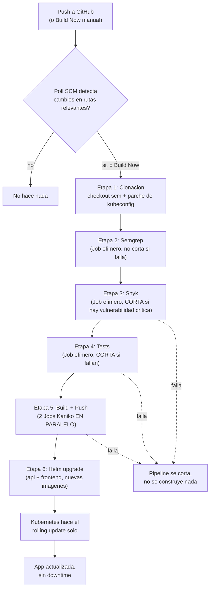

# Arquitectura física del cluster de la UCU — Pet-Core

> Qué hay realmente corriendo en el namespace `alumno-team8`, pod por pod, cómo se conectan entre sí, y cómo fluye el pipeline de Jenkins de punta a punta. Datos sacados del cluster real (`kubectl get ... -n alumno-team8`), no de un diseño teórico.
>
> Documento relacionado: [`CLUSTER_UCU_DESPLEGADO.md`](./CLUSTER_UCU_DESPLEGADO.md) — ahí viven las decisiones (por qué Jenkins quedó así, Kaniko sin privilegios, etc.), el `Jenkinsfile.ucu` explicado etapa por etapa, y la tabla de problemas reales con su solución. Este documento es solo diagramas y descripción física.

## Índice

1. [Vista general](#1-vista-general)
2. [El namespace y sus límites](#2-el-namespace-y-sus-límites)
3. [Componentes permanentes](#3-componentes-permanentes)
   - 3.1 [`postgres`](#31-postgres)
   - 3.2 [`api`](#32-api)
   - 3.3 [`frontend`](#33-frontend)
   - 3.4 [`jenkins`](#34-jenkins)
4. [Componentes efímeros (los Jobs del pipeline)](#4-componentes-efímeros-los-jobs-del-pipeline)
5. [Cómo se comunican entre sí (red interna)](#5-cómo-se-comunican-entre-sí-red-interna)
6. [Cómo se llega desde afuera (red externa)](#6-cómo-se-llega-desde-afuera-red-externa)
7. [El flujo completo del pipeline de Jenkins](#7-el-flujo-completo-del-pipeline-de-jenkins)
8. [Tabla resumen: quién habla con quién](#8-tabla-resumen-quién-habla-con-quién)

---

## 1. Vista general

Cuatro pods **permanentes** (`postgres`, `api`, `frontend`, `jenkins`) y, mientras corre un pipeline, un puñado de pods **efímeros** que se crean y se autodestruyen (uno por cada etapa del `Jenkinsfile.ucu` que necesita ejecutar algo).

---

## 2. El namespace y sus límites

Todo vive en el namespace `alumno-team8`, con una `ResourceQuota` (`student-quota`) que pone techo a todo el namespace, no a cada pod individualmente:

| Recurso | Límite | Uso típico actual |
|---|---|---|
| Pods simultáneos | 15 | 4 permanentes + hasta 2-3 efímeros durante un build |
| CPU (requests / limits) | 2 / 4 | ~0.5-1 en reposo, sube durante un build |
| Memoria (requests / limits) | 3Gi / 6Gi | ~1.5-2Gi en reposo |
| Almacenamiento total | 5Gi | 1Gi (`postgres`) + 2Gi (`jenkins`) = 3Gi usados, 2Gi libres |
| PersistentVolumeClaims | 3 | 2 usadas (`postgres-data`, `jenkins-home`) |
| LoadBalancers | 0 | — (por eso no hay Services tipo `LoadBalancer`, todo es `ClusterIP`) |

La cuenta (`ServiceAccount` `team8`) con la que opera todo esto es **namespace-scoped**: puede crear Deployments, Services, PVCs, Secrets, ConfigMaps, Jobs y `ApisixRoute` dentro de `alumno-team8`, pero no puede crear `Role`/`RoleBinding` (ni ahí ni en ningún lado) ni ningún recurso cluster-scoped (ClusterRole, CRD, Webhook, Namespace). Esto condicionó varias decisiones de diseño (ver `CLUSTER_UCU_DESPLEGADO.md`, sección 4).

---

## 3. Componentes permanentes

### 3.1 `postgres`

- **Qué es:** un `StatefulSet` de una sola réplica (`postgres-0`), imagen `postgres:16-alpine` (vía la chart de Helm).
- **Almacenamiento:** PVC propio `postgres-data-postgres-0`, 1Gi, `local-path`. Los datos sobreviven a que el pod se recree.
- **Puerto:** 5432.
- **Con quién habla:** solo lo alcanza el pod `api` (nadie más necesita la base directamente). Se encuentra por el nombre del Service `db` (DNS interno: `db.alumno-team8.svc.cluster.local`, o simplemente `db` desde dentro del mismo namespace).
- **Configuración:** `ConfigMap postgres-init` (scripts de `db/init/`, montados para la inicialización) y `Secret postgres-secret` (contraseña).

### 3.2 `api`

- **Qué es:** `Deployment` de 1 réplica, imagen `manuelney67/clinica-veterinaria:build-N` (el backend FastAPI de Pet-Core). `N` es el número de build de Jenkins que la construyó.
- **Puerto:** 8000.
- **Con quién habla:**
  - Hacia adentro: consulta a `postgres` vía el Service `db:5432`.
  - Hacia afuera: solo la alcanza el `frontend` (proxy interno `/api/`) — no tiene ninguna ruta pública propia en APISIX, a propósito (ver sección 6.1).
- **Configuración:** `ConfigMap api-config` (config no sensible) + `Secret jwt-secret` (clave de firma JWT) + `Secret postgres-secret` (para conectarse a la base).
- **Quién la actualiza:** la última etapa del `Jenkinsfile.ucu` (`helm upgrade`), que le cambia la imagen. El `Deployment` hace el *rolling update* solo (estrategia por defecto, sin configuración especial).

### 3.3 `frontend`

- **Qué es:** `Deployment` de 1 réplica, imagen `manuelney67/clinica-frontend:build-N` — un nginx sirviendo los archivos estáticos de React (Vite) más un proxy interno a la API.
- **Puerto:** 8080.
- **Con quién habla:**
  - Hacia adentro: reenvía `/api/*` al Service `api:8000` (su propio `nginx.conf` tiene ese `location`).
  - Hacia afuera: lo alcanza directamente el navegador del usuario, a través de APISIX.
- **Particularidad:** es la **misma imagen** la que sirve en local/minikube (en la raíz, `/`) y en el acceso público (también en la raíz, desde que se usa el subdominio `petcore.reto-ucu.net` en vez de un path con prefijo — ver sección 6).

### 3.4 `jenkins`

- **Qué es:** `Deployment` de 1 réplica, imagen `jenkins/jenkins:lts`, con un `initContainer` que le instala `kubectl` y `helm` (la imagen no los trae).
- **Puerto:** 8080 (distinto del namespace del Service `frontend`, no hay conflicto porque cada Service tiene su propia IP interna).
- **Almacenamiento:** PVC propio `jenkins-home`, 2Gi — configuración, credenciales, historial de builds.
- **Con quién habla:**
  - **No** tiene Docker ni ningún daemon de contenedores — para construir o testear, **lanza Jobs nuevos** usando `kubectl apply` (con el kubeconfig de la credencial `KUBECONFIG_UCU`, re-apuntado a la dirección interna del API server — ver `CLUSTER_UCU_DESPLEGADO.md`, sección 6).
  - Al final del pipeline, le habla directo a la API de Kubernetes para hacer `helm upgrade` sobre `api` y `frontend`.
- **Cómo se accede:** nadie le pega directo por su IP — se entra vía `kubectl port-forward svc/jenkins 8081:8080 -n alumno-team8`, desde la notebook de cada integrante, con su propio kubeconfig. No está expuesto a internet (decisión de seguridad).

---

## 4. Componentes efímeros (los Jobs del pipeline)

Durante una corrida del pipeline, Jenkins crea (y destruye solo, vía `ttlSecondsAfterFinished: 300`) hasta 5 pods temporales, uno por etapa. Todos siguen el mismo patrón: un `initContainer` que clona el repo (`alpine/git`, directo desde GitHub — es público) + un contenedor principal que hace el trabajo y termina.

| Pod efímero | Imagen principal | Qué hace | Vive hasta |
|---|---|---|---|
| `semgrep-N` | `semgrep/semgrep` | Análisis estático del código | Termina y Jenkins lee su log |
| `snyk-N` | `node:22-alpine` | Escaneo de dependencias (backend + frontend) | Termina y Jenkins lee su log |
| `pytest-N` | `python:3.13-slim` | Corre los tests | Termina y Jenkins lee su log |
| `kaniko-backend-N` | `gcr.io/kaniko-project/executor` | Construye y publica la imagen del backend | Termina (corre en paralelo con el de frontend) |
| `kaniko-frontend-N` | `gcr.io/kaniko-project/executor` | Construye y publica la imagen del frontend | Termina (corre en paralelo con el de backend) |

Ninguno de estos pods queda corriendo entre builds — por eso no aparecen en el diagrama de la sección 1 como parte "fija" del cluster, solo como una caja genérica ("Pods efímeros").

---

## 5. Cómo se comunican entre sí (red interna)

Dentro del namespace, nada se encuentra por IP (las IPs de los pods cambian cada vez que se recrean) — todo se encuentra por el nombre del **Service** correspondiente, resuelto por el DNS interno del cluster:

- `frontend → api`: por el nombre de Service `api`, puerto 8000.
- `api → postgres`: por el nombre de Service `db` (así se llama el Service, no `postgres`), puerto 5432.
- `jenkins → Jobs`: no es una conexión de red directa — Jenkins le **pide a la API de Kubernetes** que cree el Job, y después consulta su estado y logs, también a través de la API (nunca habla directo con el pod del Job).
- Los Jobs efímeros sí salen a **internet real** (GitHub para clonar, Docker Hub para publicar) — tráfico saliente, que se confirmó que funciona sin restricciones.

---

## 6. Cómo se llega desde afuera (red externa)

Dos caminos completamente separados, para dos cosas distintas:

### 6.1 A la app (pública, cualquiera puede entrar)

- URL: **`https://petcore.reto-ucu.net/`**.
- `reto-ucu.net` tiene DNS wildcard — no hace falta que nadie registre `petcore` a mano, cualquier subdominio resuelve al mismo gateway.
- La `ApisixRoute` (`petcore-route`, en `k8s/apisix-route-ucu.yaml`) tiene **una sola regla**, que manda todo (`/*`) al Service `frontend`. El Service `api` **no tiene ninguna ruta pública** — a propósito: los clientes solo deben hablar con el frontend, nunca directo con el backend. Las llamadas a `/api/...` las resuelve el propio `nginx.conf` del `frontend` (reenvía internamente a `http://api:8000`), no APISIX.
- El Ingress nginx que también genera la chart de Helm (`host: petcore.local`) **no** participa de este camino — queda apuntando a una IP interna del cluster, solo sirve para pruebas dentro del cluster o con `port-forward`.

### 6.2 A Jenkins (privado, solo el equipo)

- No hay ninguna URL pública para Jenkins — a propósito (ver `CLUSTER_UCU_DESPLEGADO.md`, sección 4.4).
- Cada persona que necesite entrar corre su propio `port-forward`, con su copia del kubeconfig del equipo.

---

## 7. El flujo completo del pipeline de Jenkins

Explicación de cada salto:

1. **Disparo**: alguien hace `git push`, o entra a Jenkins y aprieta "Build Now". Si es por push, Jenkins no se entera al instante (no hay webhook) — espera a que el `Poll SCM` (cada 5 minutos) note el commit nuevo, y solo si tocó una de las rutas configuradas (`app/`, `frontend/`, `helm-chart/`, etc. — ver `CLUSTER_UCU_DESPLEGADO.md`, sección 5).
2. **Clonación**: Jenkins descarga el código a su propio workspace, y de paso arma el kubeconfig "interno" que van a usar todas las etapas siguientes (necesario porque la dirección pública del cluster no es alcanzable desde adentro).
3. **Semgrep**: un Job analiza el código. Si encuentra algo, lo reporta en el log, pero **no frena nada** — es informativo.
4. **Snyk**: un Job escanea las dependencias de backend y frontend. Si hay una vulnerabilidad de severidad crítica, el pipeline **se corta ahí** — no sigue a construir ni a desplegar nada con una vulnerabilidad conocida sin resolver.
5. **Tests**: un Job corre la suite de `pytest`. Si falla algo, también corta.
6. **Build + Push**: dos Jobs de Kaniko, uno para el backend y otro para el frontend, corriendo **al mismo tiempo** (no uno después del otro). Cada uno clona el repo por su cuenta, construye la imagen sin Docker ni privilegios, y la publica en Docker Hub.
7. **Deploy**: Jenkins le dice a Helm "los Deployments `api` y `frontend` ahora usan esta imagen nueva". Helm actualiza el manifest; a partir de ahí, es **Kubernetes** quien ejecuta el *rolling update* (crea pods nuevos, espera que estén sanos, recién ahí apaga los viejos) — ni Jenkins ni Helm hacen ese paso, solo lo piden.
8. **Resultado**: la app pública (`https://petcore.reto-ucu.net/`) queda sirviendo la versión nueva, sin que haya habido un momento de caída.

---

## 8. Tabla resumen: quién habla con quién

| Origen | Destino | Protocolo / forma | Para qué |
|---|---|---|---|
| Navegador | Gateway APISIX | HTTPS | Entrada pública a la app |
| APISIX | Service `frontend` | HTTP interno | Sirve la app React — **única ruta pública que existe** |
| Pod `frontend` | Service `api` | HTTP interno | El propio nginx del frontend reenvía `/api/*` — el backend no tiene ninguna ruta pública propia en APISIX |
| Pod `api` | Service `db` | PostgreSQL (TCP 5432) | Leer/escribir datos |
| Notebook de un integrante | Pod `jenkins` | `kubectl port-forward` (túnel vía API de Kubernetes) | Usar la UI de Jenkins |
| Pod `jenkins` | API de Kubernetes (interna) | HTTPS, con el token de `team8` | Crear/consultar Jobs, hacer `helm upgrade` |
| Jobs efímeros | GitHub | HTTPS saliente | Clonar el código a analizar/testear/construir |
| Jobs efímeros (Kaniko) | Docker Hub | HTTPS saliente | Publicar las imágenes nuevas |
| Nodos del cluster | Docker Hub | Pull de imagen | Bajar `manuelney67/clinica-*` al crear pods de `api`/`frontend` |

Lo que **no** existe: ninguna conexión directa desde afuera del cluster hacia `postgres` ni hacia `api` — ambos solo son alcanzables desde dentro del namespace (`api` únicamente por el propio `frontend`) — y ninguna URL pública hacia Jenkins.
