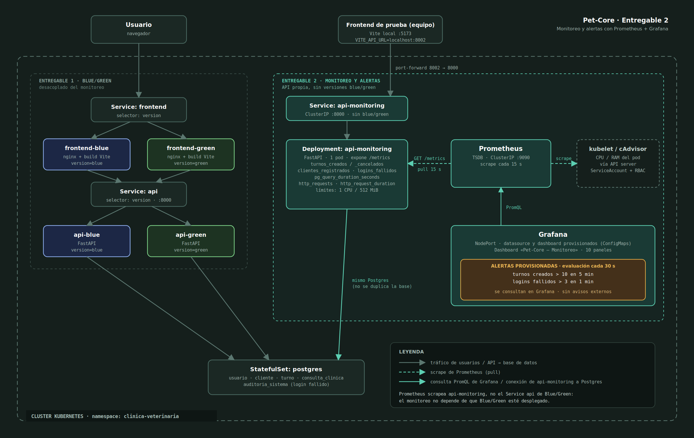
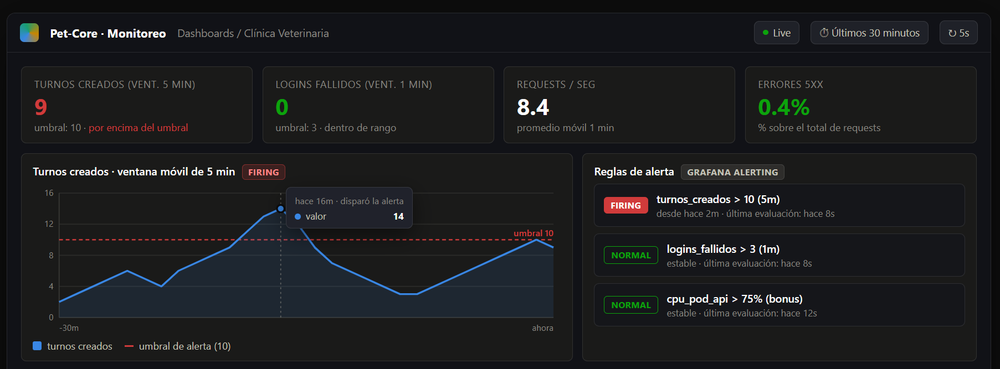
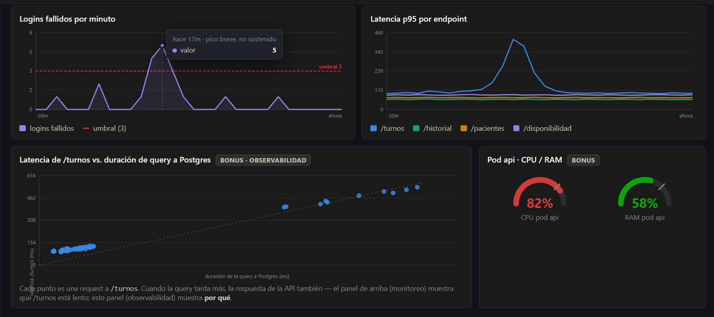

# Entregable 2 — Monitoreo y Alertas (Pet-Core)

Este documento tiene un plan para el segundo entregable de Devops en el mismo vamos a tomar la app que utilizamos para la primer entrega (con FastAPI + Postgres, ya desplegada en Kubernetes con la estrategia Blue/Green) con un sistema
de monitoreo y alertas, contenerizado y desplegado en el mismo cluster de k8s.

## Lo que pide la consigna

Implementar un sistema de monitoreo y alertas que dispare un aviso si se supera una determinada cantidad de X operaciones en un período de Y minutos. Solución contenerizada y desplegada en un cluster de Kubernetes.

El stack "recomendado" por la cátedra es Java/Spring Boot + Prometheus + Grafana. Como nosotros ya realizamos Pet-Core en FastAPI y corriendo en K8s, utilizaremos ese stack — Prometheus/Grafana son agnósticos al lenguaje de la app que monitorean.

## Qué vamos a monitorear en este entregable

### 1. Métrica de negocio (requisito explícito del entregable)

- **Turnos creados**: Va ser un contador `turnos_creados_total`, incrementado en
  `TurnoRepository.crear_turno` cada vez que se crea un turno exitosamente.
- **Alerta**: dispara si se superan los **10 turnos creados en 5 minutos**.

**Stats de negocio adicionales (solo paneles por ahora, no van a agregan alertas nuevas):**

- **Clientes nuevos registrados**: contador en el alta de `Register/clients`.
- **Turnos cancelados**: contador en `TurnoRepository.cancelar`. Panel pensado para
  mostrarse como "cancelados hoy" (acumulado de las últimas 24h vía PromQL). Combinado con turnos creados permite ver un ratio cancelación/creación en el
  dashboard que puede estar bueno.

**Idea opcional (todavía no confirmada y se puede implementar despué):**

- **Turnos marcados `NO_ASISTIO`**: ya se generan solos en
  `app/turnos/tareas_programadas.py` (hay un servicio periódico corriendo que vence automaticamente los turnos) —
  solo faltaría contarlos, sin tocar la lógica existente. Queda como posible panel
  extra si da el tiempo.

### 2. Métricas de aplicación (Lo que anotaron Belén y Martin)

- Tasa de requests por endpoint.
- Latencia promedio por endpoint.
- Tasa de errores HTTP 5xx.
- Se obtienen prácticamente automático vía `prometheus-fastapi-instrumentator` sobre la
  app FastAPI — cubre las ideas de "requests por minuto" y "latencia por endpoint".

### 3. Métrica de seguridad: intentos de login fallidos en un período de tiempo

- **Logins fallidos:** el contador se incrementa en `LoginRepository.registrar_intento_fallido`, después de confirmar la transacción que actualiza los intentos de la cuenta y escribe en `auditoria_sistema`. No consulta ni recuenta los registros históricos de auditoría. Actualmente cuenta contraseñas incorrectas de usuarios existentes, incluido el intento que activa el bloqueo; no cuenta correos inválidos, usuarios inexistentes ni intentos realizados durante un bloqueo ya activo.

- **Alerta:** se genera cuando hay más de 3 intentos fallidos en un minuto. Se eligió un intervalo corto para detectar posibles ataques antes de que se active el bloqueo de la cuenta, que ocurre al llegar a 5 intentos fallidos en `Auth/login`.

- **Relación con la protección existente:** el `LoginService` (RNF-02) ya bloquea la cuenta durante 15 minutos después del quinto intento fallido y reinicia el contador cuando el usuario inicia sesión correctamente. Esta métrica no busca reemplazar ese mecanismo, sino complementarlo. La idea es que el equipo pueda detectar comportamientos sospechosos en tiempo real, como un ataque distribuido que afecte a varias cuentas al mismo tiempo. En otras palabras, el bloqueo protege cada cuenta, mientras que el monitoreo permite tener una visión más general de lo que está pasando en el sistema.

- **Alcance del contador:** el contador es global, es decir, suma los intentos fallidos de todo el sistema y no los separa por cuenta. Esto permite detectar una cantidad inusual de errores de inicio de sesión en poco tiempo, aunque también puede generar falsas alarmas. Por ejemplo, varios usuarios que se equivoquen al ingresar su contraseña durante el mismo minuto podrían activar la alerta sin que exista un ataque. Se decidió mantener este enfoque porque el bloqueo por cuenta ya cubre ese caso de forma individual. De todas formas, es importante aclarar en el informe que se trata de una simplificación consciente y que la alerta debe interpretarse teniendo en cuenta este posible escenario.

### 4. Observabilidad y bonus

- **CPU/RAM del pod de la API > 75%**: requiere scrapear métricas de nodo/pod vía
  cAdvisor/kubelet (RBAC + service discovery de Kubernetes en Prometheus), más esfuerzo de
  infraestructura que las métricas anteriores.
- **Correlación latencia de endpoint ↔ duración de queries a Postgres**: panel que
  reproduce literalmente el ejemplo de la teórica ("el monitoreo detecta que la API
  responde lento; la observabilidad muestra que la causa es una query lenta en la BD").

## Qué decidimos no hacer

- **No** se mete blue/green dentro del sistema de métricas (nada de labels
  `version=blue|green` en los contadores).
- **No se reusa el Service/Deployments de Blue/Green como blanco de Prometheus.**
  Blue/Green es un requisito del entregable 1, no de este. Se creó un Deployment propio y
  simple para este entregable (`api-monitoring`, sin versiones, sin selector de blue/green)
  — ver la sección siguiente. Esto evita que el monitoreo dependa de que Blue/Green estén
  mergeados o desplegados en ninguna rama.

## Cómo queda desacoplado de Blue/Green (entregable 1)

- **`api-monitoring`** (`k8s/api-monitoring-deployment.yaml` + `k8s/api-monitoring-service.yaml`)
  es un Deployment de un solo Pod, con su propio Service, sin labels `version: blue/green`
  ni relación con los Services `api`/`frontend` existentes. Reusa la misma imagen y el
  mismo Postgres (StatefulSet `postgres`) que ya existe — no se duplica la base de datos.
- **Prometheus scrapea `api-monitoring:8000`**, no el Service `api` de Blue/Green — así el
  monitoreo no le importa en absoluto si Blue/Green están desplegados, en qué rama están,
  ni a qué versión apunta el selector en un momento dado.
- **`scripts/k8s-up-monitoring.ps1`** (nuevo) levanta namespace + secrets + Postgres +
  `api-monitoring` + Prometheus + Grafana de punta a punta, sin revisar en qué rama de git
  se está parado (a diferencia de `k8s-up.ps1`/`k8s-up-green.ps1`, que sí lo exigen).
  Cualquiera de los 4 puede correr este script sin tener Blue/Green desplegado primero.
- Nada de esto toca `api-blue-deployment.yaml`, `api-green-deployment.yaml`,
  `api-service.yaml` ni los scripts `k8s-up.ps1`/`k8s-switch-*.ps1` existentes — mismo
  criterio que ya se sigue con los scripts SQL de `db/init/` (se agrega, no se edita lo que
  ya funciona).

## Arquitectura



> El diagrama de arriba todavía muestra la versión anterior (Prometheus apuntando al
> Service `api` de Blue/Green) — quedó desactualizado tras la decisión de desacoplar de
> Blue/Green (ver sección anterior). Pendiente de rehacer con `api-monitoring` en el medio.

Resumen del flujo (actualizado):

1. Prometheus scrapea `GET /metrics` del `Service: api-monitoring` cada 15s (pull) — un
   Deployment propio de este entregable, sin relación con `api-blue`/`api-green`.
2. Grafana consulta Prometheus vía PromQL y arma los dashboards (tasa de requests,
   latencia, errores 5xx, turnos creados, logins fallidos).
3. Grafana evalúa las reglas de alerta sobre esas series cada 30 segundos y pasa a `Firing` si
   `turnos_creados` supera 10 en 5 minutos, o `logins_fallidos` supera 3 en 1 minuto.
   La activación se consulta en Grafana; no se configuraron avisos por correo ni webhook.

## Piezas a desplegar (nuevas, en `k8s/`)

- `api-monitoring-deployment.yaml` + `api-monitoring-service.yaml` — la API sin
  Blue/Green, el único blanco de Prometheus.
- `prometheus-configmap.yaml` — configuración de scrape (target: Service
  `api-monitoring`).
- `prometheus-deployment.yaml` + `prometheus-service.yaml` (`ClusterIP`, sin acceso
  externo).
- `grafana-deployment.yaml` + `grafana-service.yaml` (`NodePort`) — con Prometheus como
  datasource ya provisionado.
- `grafana-dashboard-configmap.yaml` — el dashboard de 5 paneles, ya provisionado como
  código (no hay que armarlo a mano en la UI).
- `grafana-alerting-configmap.yaml` — las dos reglas de alerta provisionadas como código,
  montadas en `/etc/grafana/provisioning/alerting` por `grafana-deployment.yaml`.
- `scripts/k8s-up-monitoring.ps1` — levanta todo lo anterior de punta a punta, sin
  depender de ninguna rama de git.
- Cambio mínimo en la API: exponer `/metrics` (instrumentación + contadores de negocio).

## Prioridad de implementación

1. Alerta de negocio obligatoria: turnos creados > 10 en 5 min — núcleo del entregable.
2. Métricas de aplicación (requests, latencia, errores 5xx) — relleno barato vía
   instrumentator.
3. Alerta de logins fallidos: > 3 en 1 min — segundo caso de "X en Y minutos", reutiliza
   auditoría existente.
4. Correlación latencia-vs-query (Postgres) — el ejemplo monitoreo vs. observabilidad que fue lo qu vimos en clase, aplicado al proyecto.
5. CPU/RAM del pod de la API > 75% (cAdvisor/kubelet) — la pieza de infraestructura
   pura, con más configuración de K8s (RBAC + service discovery).

## Alertas definidas

| Alerta | Condición | Motivo |
|---|---|---|
| Turnos creados | > 10 en 5 min | Requisito obligatorio del enunciado, escala realista |
| Logins fallidos | > 3 en 1 min | Aviso temprano, por debajo del bloqueo de cuenta (5 intentos) de `Auth/login` |

## Contrato de nombres de métricas

Nombres ya definidos, para que Prometheus/Grafana se puedan configurar sin esperar al
código final de la API:

| Métrica | Tipo | Dónde se incrementa/mide |
|---|---|---|
| `turnos_creados_total` | counter | `TurnoRepository.crear_turno` |
| `turnos_cancelados_total` | counter | `TurnoRepository.cancelar` |
| `clientes_registrados_total` | counter | alta en `Register/clients` |
| `logins_fallidos_total` | counter | mismo evento que ya escribe en `auditoria_sistema` (global, sin label por cuenta — ver nota más arriba) |
| `pg_query_duration_seconds` | histogram | alrededor de la query pesada del endpoint de turnos |
| `http_requests_total` | counter | automático, lo agrega `prometheus-fastapi-instrumentator` |
| `http_request_duration_seconds` | histogram | automático, idem |

## Ya hecho (base común, no repartir esto)

Esto ya está commiteado y probado funcionando en Minikube — ninguna de las tareas de abajo
necesita tocarlo para arrancar:

- API instrumentada (`/metrics`, contador de turnos creados, contador de logins fallidos).
- `api-monitoring` + Prometheus + Grafana desplegados en `k8s/`, desacoplados de
  Blue/Green, levantables con `scripts/k8s-up-monitoring.ps1` sin depender de ninguna rama.
- Dashboard con 5 paneles ya provisionado como código (`k8s/grafana-dashboard-configmap.yaml`):
  turnos creados, logins fallidos, tasa de requests por endpoint, latencia p95 por
  endpoint, errores 5xx.
- Probado levantando todo de cero (no solo "funcionó una vez").
- Punto 1 completado y verificado el 16/10/2026: ambas reglas provisionadas en Grafana
  llegaron a `Firing` con operaciones reales. Detalles y reproducción en
  [Reglas de alerta implementadas y cómo probarlas](#reglas-de-alerta-implementadas-y-cómo-probarlas).

## Tareas pendientes (para repartir entre el equipo)

Las tareas 2 a 6 pueden iniciarse en paralelo; el punto 1 ya está completado y se conserva
con su número para mantener la referencia del equipo. Varias tareas tocan el mismo archivo de dashboard
(`k8s/grafana-dashboard-configmap.yaml`): si dos personas lo editan al mismo tiempo, avisar
antes para no pisarse al mergear.

**1. Reglas de alerta en Grafana — COMPLETADO (16/10/2026).**
- Implementado: dos reglas en `k8s/grafana-alerting-configmap.yaml`, montadas por
  `k8s/grafana-deployment.yaml`. El archivo se valida y aplica desde
  `scripts/k8s-up-monitoring.ps1`.
- Verificado: ambas reglas aparecen como `Provisioned` y llegaron a `Firing` en Minikube.
- Alcance: activación visible en Grafana; sin notificaciones externas configuradas.

**2. Contador de turnos cancelados** (`turnos_cancelados_total`)
- Qué hacer: mismo patrón que `turnos_creados_total` — contador en
  `TurnoRepository.cancelar`, panel nuevo en el dashboard ("cancelados hoy").
- Toca: `app/metrics.py`, `app/turnos/repository.py`, `k8s/grafana-dashboard-configmap.yaml`.

**3. Contador de clientes nuevos registrados** (`clientes_registrados_total`)
- Qué hacer: contador en el alta de `app/Auth/Register/clients/`, panel nuevo.
- Toca: `app/metrics.py`, `app/Auth/Register/clients/*.py`, `k8s/grafana-dashboard-configmap.yaml`.

**4. Métrica de duración de query + panel de correlación — IMPLEMENTADO (17/10/2026)**
- Qué hacer: medir cuánto tarda la query pesada del endpoint de turnos
  (`pg_query_duration_seconds`, histograma), y armar el panel que correlaciona esa
  duración con la latencia del endpoint — el ejemplo "monitoreo vs. observabilidad" de la
  teórica, aplicado al proyecto.
- Toca: `app/metrics.py`, `app/turnos/repository.py`, `k8s/grafana-dashboard-configmap.yaml`.

**5. CPU/RAM del pod (bonus, el más de infraestructura) — IMPLEMENTADO (17/10/2026)**
- Qué hacer: RBAC (`ClusterRole`/`ClusterRoleBinding`) para que Prometheus pueda scrapear
  cAdvisor/kubelet, sumar el target en `prometheus-configmap.yaml`, gauge en el dashboard.
- Toca: archivo de RBAC nuevo en `k8s/`, `k8s/prometheus-configmap.yaml`,
  `k8s/grafana-dashboard-configmap.yaml`.

Implementado con `k8s/prometheus-rbac.yaml`, ServiceAccount propio de Prometheus y
descubrimiento de nodos. El job `kubernetes-cadvisor` consulta cAdvisor mediante el
API server usando el token del ServiceAccount y la CA del clúster. Solo conserva las
cinco métricas necesarias del cgroup de los pods `api-monitoring` (etiqueta
`container=""` e `id` del pod, sin sumar otra vez los contenedores hijos).
El permiso `nodes/proxy` permite acceder al kubelet mediante el API server y tiene
alcance de clúster; no debe asignarse al ServiceAccount de la aplicación.

Los dos gauges muestran un porcentaje **por pod respecto del límite del contenedor**:
CPU (promedio de 2 minutos / 1 núcleo) y RAM (working set / 512 MiB). Los límites están
en `api-monitoring-deployment.yaml`; los denominadores se leen desde cAdvisor, por lo
que las consultas siguen funcionando si se cambian esos límites. Rojo desde el 75%.
Este punto agrega indicadores visuales, no nuevas reglas de alerta.

### Cómo verificar el punto 5

1. Encender Docker Desktop y ejecutar desde la raíz:

   ```powershell
   powershell -NoProfile -ExecutionPolicy Bypass -File .\scripts\k8s-up-monitoring.ps1
   ```

2. Comprobar permisos (debe devolver `yes`):

   ```powershell
   minikube kubectl -- auth can-i get nodes/proxy --as=system:serviceaccount:clinica-veterinaria:prometheus
   minikube kubectl -- auth can-i list nodes --as=system:serviceaccount:clinica-veterinaria:prometheus
   ```

3. Abrir Grafana y esperar unos 2 minutos para reunir muestras de CPU:

   ```powershell
   powershell -NoProfile -ExecutionPolicy Bypass -File .\scripts\k8s-open-grafana.ps1
   ```

   En **Pet-Core → Pet-Core — Monitoreo**, al final aparecen los gauges CPU y RAM,
   con valores numéricos por pod. Un uso bajo en reposo es esperable. `No data` no
   equivale a cero y debe investigarse.

4. En **Explore**, con el datasource Prometheus, consultar:

   ```promql
   up{job="kubernetes-cadvisor"}
   container_memory_working_set_bytes{job="kubernetes-cadvisor",namespace="clinica-veterinaria",container="",id=~".*/[^/]*pod[^/]+"}
   container_spec_cpu_quota{job="kubernetes-cadvisor",namespace="clinica-veterinaria",container="",id=~".*/[^/]*pod[^/]+"}
   container_spec_memory_limit_bytes{job="kubernetes-cadvisor",namespace="clinica-veterinaria",container="",id=~".*/[^/]*pod[^/]+"}
   ```

   `up` debe valer 1 por nodo; memoria debe ser positiva y su límite 536870912 bytes.
   La cuota CPU debe ser positiva. Si faltan las métricas `container_spec_*`, revisar
   la exposición de cAdvisor del clúster: sin denominador el gauge muestra `No data`.
   Para ver errores del target, abrir temporalmente Prometheus:

   ```powershell
   minikube kubectl -- port-forward svc/prometheus 9090:9090 -n clinica-veterinaria
   ```

   Entrar a `http://localhost:9090/targets` y revisar `kubernetes-cadvisor`.
   Para comprobar visualmente el umbral sin forzar consumo, duplicar temporalmente
   un panel en Grafana, reemplazar su consulta por `vector(80)` y verificar el rojo;
   descartar esa edición al terminar. Esto solo prueba la presentación del umbral.

Validación local: YAML, JSON del dashboard y sintaxis PowerShell comprobados.
Verificación en vivo: cAdvisor accesible y límites del pod confirmados en Minikube.
Se corrigió el filtro inicial por contenedor para usar el cgroup del pod que expone este clúster.

**6. Rehacer el diagrama de arquitectura**
- Qué hacer: `entregable2-diagrama-arquitectura.png` todavía muestra la versión vieja
  (Prometheus apuntando al Service `api` de Blue/Green). Rehacerlo con `api-monitoring` en
  el medio, reflejando el diseño desacoplado actual.
- Toca: solo la imagen, nada de código.

**7. Evidencia final + informe de entrega** — depende de que la tarea 1 (alertas) esté
lista, así que conviene agarrarla después de esa.
- Qué hacer: capturas reales del dashboard y de una alerta en estado "Firing" (reemplazando
  las capturas simuladas que hoy están en este documento), y armar el documento/informe
  final para entregar.
- Toca: capturas nuevas + este documento.

## Estado verificado en Minikube

Esto ya se probó corriendo de verdad, con el diseño desacoplado actual (`api-monitoring`,
no Blue/Green):

- Prometheus scrapea `api-monitoring:8000/metrics` y el target queda en estado `up`.
- `turnos_creados_total` y `logins_fallidos_total` aparecen como series consultables en
  Prometheus y aumentaron con reservas e intentos de login reales.
- Se crearon 12 reservas exitosas en menos de 5 minutos mediante `api-monitoring`.
  Prometheus confirmó que se superó el umbral y Grafana mostró la regla de turnos activa.
- Tras los intentos de login fallidos, se comprobó en Grafana que ambas reglas estaban
  activas simultáneamente, con una instancia de alerta cada una.
- Grafana arranca sano y el datasource "Prometheus" queda provisionado solo al arrancar.
- `scripts/k8s-up-monitoring.ps1` corrido dos veces seguidas (para probar que reinicia
  Prometheus/Grafana cuando sus ConfigMaps cambian, no solo la primera vez) — confirmado
  que el target se mantiene correcto después de volver a correrlo.
- No hizo falta tocar ni reiniciar nada de `api-blue`, `api-green`, `frontend-blue` ni
  `frontend-green`, que siguieron corriendo igual que antes durante toda la prueba.

**Recarga de configuración**: `kubectl apply` sobre un ConfigMap no hace que Grafana o
Prometheus recarguen automáticamente su configuración en memoria. Kubernetes puede
actualizar archivos montados, pero la aplicación debe releerlos.
El script ahora fuerza `rollout restart` de Prometheus y Grafana en cada corrida para que
esto no le pase a nadie si vuelve a correr el script después de un cambio de
configuración.

## Reglas de alerta implementadas y cómo probarlas

### Configuración y estados

Las reglas están en `k8s/grafana-alerting-configmap.yaml`, dentro del grupo
`pet-core-alertas`, carpeta `Pet-Core`, y consultan el datasource con UID `prometheus`.

| Alerta | Qué mide | Cuándo se activa |
|---|---|---|
| Exceso de turnos creados | Reservas guardadas correctamente en los últimos 5 minutos. | Cuando se superan los 10 turnos en ese período. |
| Exceso de intentos de login fallidos | Intentos con contraseña incorrecta de cuentas existentes en el último minuto. | Cuando se superan los 3 intentos en ese período. |

- Prometheus recoge los datos cada 15 segundos y Grafana comprueba las alertas cada
  30 segundos. Si detecta que se superó el límite, activa la alerta sin agregar otra espera.
- Los estados indican qué está pasando: **Normal** significa que no se supera el límite;
  **Firing**, que la alerta está activa; **No Data**, que faltan datos; y **Error**, que
  hubo un problema al comprobarlos.
- **Provisioned** significa que la alerta se creó desde un archivo del proyecto. Para
  modificarla, se cambia ese archivo.
- Se revisan siempre los últimos 5 minutos para los turnos y el último minuto para los
  logins. Cuando pasa el tiempo y ya no se supera el límite, la alerta vuelve a **Normal**.
  Los gráficos pueden mostrar decimales porque calculan una estimación a partir de los
  datos recogidos.
- Para ver las alertas, entrar en **Alerting → Alert rules → Pet-Core → pet-core-alertas**.
- Las alertas se ven en Grafana. No se envían avisos por correo ni a otros servicios.

### Desplegar o actualizar las reglas

Para levantar el entorno completo, seguir los requisitos y las instrucciones de
[Monitoreo con Prometheus y Grafana](README.md#monitoreo-con-prometheus-y-grafana).
El script `scripts/k8s-up-monitoring.ps1` ya incluye el ConfigMap de alertas.

Si el entorno ya está levantado y solo se modificaron las reglas, ejecutar desde la raíz
del proyecto los siguientes comandos, uno por uno, continuando si el anterior termina bien:

```powershell
minikube kubectl -- apply -f k8s/grafana-alerting-configmap.yaml
minikube kubectl -- rollout restart deployment/grafana -n clinica-veterinaria
minikube kubectl -- rollout status deployment/grafana -n clinica-veterinaria --timeout=180s
```

Para cambiar X, modificar la expresión B de la regla; para cambiar Y, modificar la ventana
`[5m]` o `[1m]` en la consulta A y mantener coherente `relativeTimeRange.from` (en segundos).
Actualizar también el texto de la regla y el panel correspondiente si cambian los umbrales.

### Preparar el frontend para las pruebas

Las operaciones deben llegar a `api-monitoring`, que es el target de Prometheus. El
frontend Blue/Green habitual apunta a otra instancia de la API.

En una terminal, abrir la API de monitoreo y dejar el comando ejecutándose:

```powershell
minikube kubectl -- port-forward svc/api-monitoring 8002:8000 -n clinica-veterinaria
```

En otra terminal PowerShell, desde la raíz del proyecto:

```powershell
cd frontend
npm ci
$env:VITE_API_URL = "http://localhost:8002"
npm run dev -- --host localhost --port 5173 --strictPort
```

Abrir `http://localhost:5173`. Si se cambia el puerto del port-forward, cambiar también
`VITE_API_URL` y reiniciar Vite. Mantener ambas terminales abiertas durante la prueba.

Abrir Grafana con `scripts/k8s-open-grafana.ps1`, seleccionar **Últimos 15 minutos** y
activar actualización automática cada 5 o 10 segundos. Esperar al menos dos lecturas de
Prometheus antes de generar operaciones. Un rango de tiempo absoluto antiguo puede
mostrar cero aunque los eventos actuales se estén recolectando correctamente.

### Prueba de turnos creados

1. Entrar con un cliente de prueba activo y no bloqueado. Puede crearse desde el frontend;
   registrar una mascota si todavía no tiene ninguna.
2. Crear 12 reservas confirmadas en menos de 5 minutos, usando horarios futuros
   disponibles y sin superposición. Para vacunación, cuya duración de prueba es 15
   minutos, pueden utilizarse horarios consecutivos disponibles de 15 minutos.
3. Las fechas de atención pueden ser distintas: la ventana mide cuándo se crean las
   reservas, no cuándo ocurren las consultas. Las respuestas rechazadas no cuentan.
4. Esperar aproximadamente 15–45 segundos y actualizar las reglas. Comprobar que
   **Exceso de turnos creados** aparece en `Firing`, con una instancia activa.
5. Dejar de crear reservas y comprobar que vuelve a `Normal` cuando dejan de superar el
   umbral en la ventana móvil de 5 minutos.

Las reservas se guardan en PostgreSQL; la prueba no las elimina automáticamente.

### Prueba de logins fallidos

1. Usar una cuenta existente y no bloqueada. Iniciar sesión correctamente y cerrar sesión
   para comenzar sin intentos fallidos previos en esa cuenta.
2. Enviar cuatro intentos con el mismo correo y una contraseña incorrecta dentro de un
   minuto. Debe aparecer el mensaje de credenciales incorrectas, no un error de formato.
3. Revisar inmediatamente las reglas durante los siguientes 15–45 segundos. Comprobar
   que **Exceso de intentos de login fallidos** pasa a `Firing`. La ventana corta hace que
   pueda volver pronto a `Normal`.
4. Entrar correctamente para limpiar los intentos de la cuenta. Esto no reinicia el
   contador de Prometheus.

No acumular un quinto fallo: activa un bloqueo de 15 minutos. Si la cuenta ya está
bloqueada, esperar a que venza el bloqueo o usar otra cuenta de prueba. Los intentos
durante ese bloqueo no aumentan la métrica actual. Tampoco lo hacen los correos inválidos
ni los usuarios inexistentes. Si no se observa la transición, revisar rango temporal,
actualización del dashboard y valores de la consulta antes de repetir los intentos.

## Cómo probarlo sin depender de Blue/Green

**Importante: esto es solo para desarrollo, no reemplaza el entregable.** La consigna pide
Kubernetes explícitamente — eso es lo de `k8s/`, y es lo único que cuenta como entrega.

Hay dos formas de probar sin necesitar Blue/Green desplegado ni mergeado a ninguna rama:

1. **Kubernetes real, desacoplado** (`scripts/k8s-up-monitoring.ps1`): levanta
   `api-monitoring` + Postgres + Prometheus + Grafana en Minikube, sin revisar rama de git
   y sin necesitar que `api-blue`/`api-green` existan. Esto **sí** satisface la consigna
   (corre en un clúster de Kubernetes de verdad) y es lo que cuenta como entrega.
2. **Docker Compose** (`compose.yaml` + `monitoring/prometheus.yml` +
   `monitoring/grafana-datasources.yml`): ni siquiera necesita Kubernetes/Minikube. Sirve
   para iterar más rápido en el código de la API (`docker compose up --build`), pero no es
   lo que se entrega — la entrega final tiene que mostrarse corriendo en Kubernetes.

Las dos configuraciones de Prometheus (`k8s/prometheus-configmap.yaml` y
`monitoring/prometheus.yml`) son independientes a propósito: apuntan a nombres de Service
distintos (`api-monitoring` en K8s, `server` en Compose) porque son entornos distintos, no
hay que mantenerlos sincronizados más que en el nombre de las métricas que exponen.

## Cómo accede el equipo (decisión de exposición)

Para no sumarle una terminal nueva a cada persona por cada pieza del monitoreo:

- **Prometheus queda como `ClusterIP`** (no expuesto hacia afuera del clúster). Nadie del
  equipo necesita entrar a su UI para el día a día — eso lo hace Grafana, que ya lo tiene
  de datasource. Si alguna vez hace falta debuggear un scrape target directamente, se usa
  `kubectl port-forward svc/prometheus 9090:9090` de forma puntual.
- **Grafana sí queda expuesto** (`NodePort`), porque es lo único que el equipo necesita
  mirar. Para abrirlo, correr `scripts/k8s-open-grafana.ps1` (mismo patrón que los demás
  scripts de `scripts/`) en vez de acordarse el comando de `minikube service` a mano.
  Usuario/contraseña por defecto de la imagen: `admin` / `admin`.


## Mockup del dashboard (datos simulados, antes del código real)

Simulación de cómo quedaría el dashboard en Grafana, con los umbrales ya definidos arriba.






## Guía de implementación y pruebas

Ver [Entregable 2: monitoreo y alertas con Grafana y Prometheus](ENTREGABLE_2_GRAFANA_PROMETHEUS_MONITOREO_Y_ALERTAS.md)
para los puntos 1, 2, 4 y 5, archivos involucrados y pasos de reproducción.
El punto 4 mide el listado `GET /turnos` desde SQLAlchemy (ejecución y lectura)
y compara su p95 con el HTTP del mismo endpoint.
