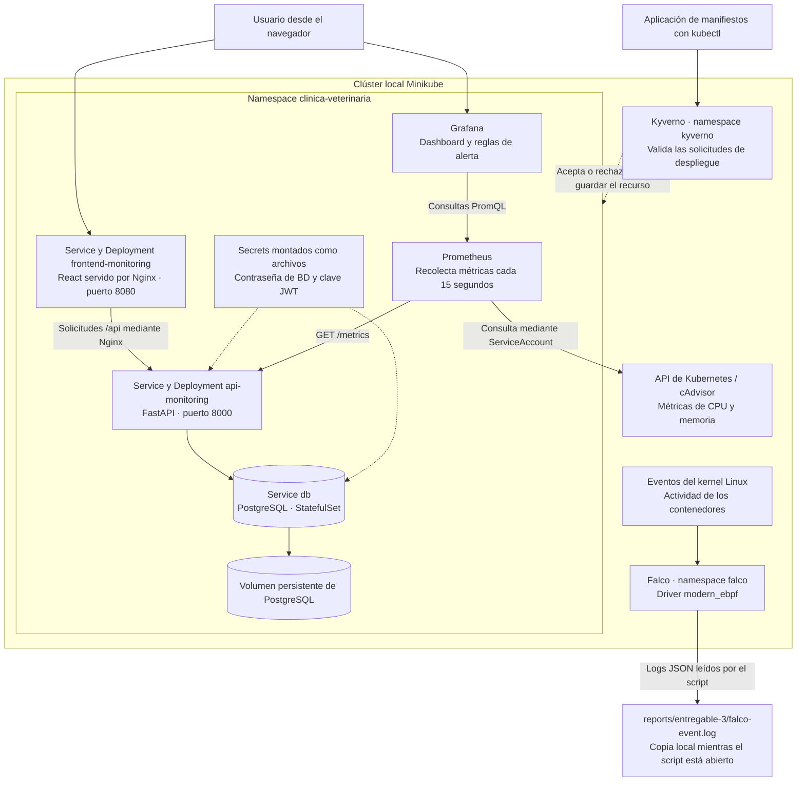
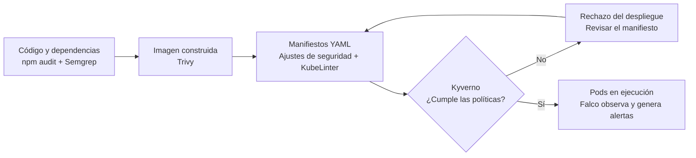

# Entregable 3 DevSecOps

## Índice

- [1. Qué se hizo y cómo se organizó el trabajo](#1-qué-se-hizo-y-cómo-se-organizó-el-trabajo)
  - [El orden de trabajo](#el-orden-de-trabajo)
  - [Herramientas utilizadas](#herramientas-utilizadas)
  - [Cómo quedó la arquitectura](#cómo-quedó-la-arquitectura)
  - [En qué momento actúa cada control](#en-qué-momento-actúa-cada-control)
  - [Resultado general](#resultado-general)
- [2. Seguridad en el código](#2-seguridad-en-el-código)
  - [2.1 Qué se revisó primero](#21-qué-se-revisó-primero)
  - [2.2 Paso 1 Revisar las dependencias con npm audit](#22-paso-1-revisar-las-dependencias-con-npm-audit)
  - [2.3 Paso 2 Revisar el código con Semgrep](#23-paso-2-revisar-el-código-con-semgrep)
- [3. Seguridad de las imágenes](#3-seguridad-de-las-imágenes)
  - [3.1 Paso 1 Escanear las imágenes antes de corregir](#31-paso-1-escanear-las-imágenes-antes-de-corregir)
  - [3.2 Paso 2 Actualizar la imagen del backend](#32-paso-2-actualizar-la-imagen-del-backend)
  - [3.3 Paso 3 Actualizar la imagen del frontend](#33-paso-3-actualizar-la-imagen-del-frontend)
  - [3.4 Paso 4 Revisar lo que sigue apareciendo](#34-paso-4-revisar-lo-que-sigue-apareciendo)
  - [3.5 Comandos utilizados para construir y analizar las imágenes](#35-comandos-utilizados-para-construir-y-analizar-las-imágenes)
- [4. Seguridad en Kubernetes](#4-seguridad-en-kubernetes)
  - [4.1 Paso 1 Ajustar la seguridad de los manifiestos](#41-paso-1-ajustar-la-seguridad-de-los-manifiestos)
  - [4.2 Paso 2 Hacer obligatorias las reglas con Kyverno](#42-paso-2-hacer-obligatorias-las-reglas-con-kyverno)
  - [4.3 Paso 3 Revisar los YAML con KubeLinter](#43-paso-3-revisar-los-yaml-con-kubelinter)
- [5. Seguridad en tiempo de ejecución: Falco](#5-seguridad-en-tiempo-de-ejecución-falco)
  - [5.1 Paso 1 Instalar Falco y dejar la captura activa](#51-paso-1-instalar-falco-y-dejar-la-captura-activa)
  - [5.2 Paso 2 Generar una actividad de prueba](#52-paso-2-generar-una-actividad-de-prueba)
  - [5.3 Paso 3 Comprobar qué detectó](#53-paso-3-comprobar-qué-detectó)
  - [5.4 Ajustes que hicieron falta durante la prueba](#54-ajustes-que-hicieron-falta-durante-la-prueba)
- [6. Hallazgos mantenidos y justificación](#6-hallazgos-mantenidos-y-justificación)
- [7. Dónde consultar la evidencia](#7-dónde-consultar-la-evidencia)
- [8. Conclusión](#8-conclusión)

## 1. Qué se hizo y cómo se organizó el trabajo

En este entregable se trabajó sobre la seguridad de la aplicación que ya estaba funcionando. Se revisaron el código, las imágenes de Docker, la configuración de Kubernetes y lo que pasa dentro de los contenedores mientras están en ejecución.

La idea fue seguir el recorrido de la aplicación: primero revisar lo que se va a construir, después analizar la imagen y, por último, comprobar cómo se despliega y cómo se comporta. En cada paso se guardó el resultado en `reports/entregable-3/`, se corrigió lo que correspondía y se dejó explicado por qué algunas alertas se mantienen.

### El orden de trabajo

Los pasos que se describen a continuación corresponden a los cambios realizados y a las pruebas registradas en el proyecto.

| Paso | Qué se hizo | Para qué |
|---|---|---|
| 1. Revisar el código | Se ejecutaron npm audit y Semgrep, se revisaron sus alertas y se aplicaron las correcciones. | Encontrar dependencias vulnerables y partes del código que necesitaban una revisión. |
| 2. Revisar las imágenes | Se escanearon backend y frontend con Trivy, se actualizaron paquetes y se repitió el escaneo. | Revisar también lo que llega dentro del contenedor, además del código propio. |
| 3. Ajustar los manifiestos | Se definieron usuarios sin root, recursos y restricciones de seguridad. | Preparar los servicios para ejecutarse con permisos y consumo más controlados. |
| 4. Validar los despliegues | Se aplicaron las tres políticas de Kyverno y se revisaron los YAML con KubeLinter. | Comprobar las reglas y evitar que se acepten despliegues que las incumplan. |
| 5. Observar la ejecución | Se instaló Falco y se abrió una shell de prueba dentro de la API. | Comprobar que una actividad sospechosa genere una alerta real. |

Primero se ajustaron los manifiestos y después se activaron las políticas de bloqueo. Esto importa porque, si se activan antes, Kubernetes puede rechazar la recreación de un pod que todavía no cumple las reglas.

### Herramientas utilizadas

La letra pide npm audit, Semgrep, Trivy, Kyverno, KubeLinter y Falco. Cada una revisa una parte distinta; por eso sus resultados se complementan.

| Herramienta | Qué revisa en este proyecto | Qué pasa si encuentra un problema |
|---|---|---|
| npm audit | Las dependencias instaladas del frontend. | Genera un reporte para revisar y actualizar paquetes. |
| Semgrep | El código del backend y del frontend, sin ejecutarlo. | Señala patrones que necesitan revisión. |
| Trivy | Los paquetes y las dependencias de las imágenes construidas. | Informa las vulnerabilidades conocidas que encuentra. |
| KubeLinter | Los manifiestos YAML, sin necesitar el clúster. | Informa configuraciones que conviene revisar. |
| Kyverno | Los recursos que se intentan crear o actualizar en Kubernetes. | Rechaza los que incumplen las políticas configuradas en `Enforce`. |
| Falco | La actividad de los contenedores mientras están funcionando. | Genera una alerta; no detiene la acción por sí solo. |

Para ejecutar y comprobar todo se usaron Docker Desktop, Minikube y `kubectl`. Minikube permite probar Kubernetes localmente y `kubectl` permite aplicar los YAML, consultar los pods y ejecutar las verificaciones. También se usó Helm para instalar Kyverno y Falco sin tener que preparar a mano todos sus archivos de configuración.

### Cómo quedó la arquitectura

El entorno de prueba usa `frontend-monitoring`, `api-monitoring`, PostgreSQL, Prometheus y Grafana. Sobre ese entorno se agregaron las políticas de Kyverno y la detección de Falco. Se conserva la separación de monitoring que ya tenía el proyecto.



El usuario entra al frontend y Nginx deriva las llamadas de `/api` a FastAPI. La API consulta la base por el Service `db`; los datos de PostgreSQL se guardan en un volumen persistente. Prometheus consulta las métricas de la API y de cAdvisor, y Grafana usa esos datos para sus paneles y alertas.

Kyverno interviene al crear o actualizar recursos de Kubernetes. Falco observa la actividad durante la ejecución. Ninguno está en el recorrido de las solicitudes del navegador hacia la API.

### En qué momento actúa cada control



Este diagrama resume el recorrido de las revisiones. Los análisis se ejecutaron con los comandos documentados abajo; no representa un pipeline automatizado de CI/CD.

### Resultado general

Se actualizaron las dependencias vulnerables del frontend, se agregó una lista de columnas permitidas al actualizar mascotas y se actualizaron las imágenes. También se ajustaron los manifiestos y se comprobó que Kyverno rechaza los casos de prueba que incumplen las políticas. Con Falco se registró la apertura intencional de una shell dentro del backend.

Quedaron alertas revisadas y riesgos documentados, con sus motivos en la sección 6. Los resultados corresponden a los reportes guardados: al repetir un análisis pueden cambiar por nuevas versiones o nuevas vulnerabilidades publicadas.

## 2. Seguridad en el código

**Reportes:** [`npm-audit-inicial.txt`](reports/entregable-3/npm-audit-inicial.txt), [`npm-audit.txt`](reports/entregable-3/npm-audit.txt), [`semgrep-inicial.txt`](reports/entregable-3/semgrep-inicial.txt), [`semgrep.txt`](reports/entregable-3/semgrep.txt).

### 2.1 Qué se revisó primero

La revisión del código tiene dos partes: las bibliotecas que utiliza la aplicación y el código escrito en el proyecto. Se revisan por separado porque una dependencia puede tener una vulnerabilidad conocida, mientras que un error propio puede estar en la forma de construir una consulta o procesar un dato.

| Herramienta | Qué analiza |
|---|---|
| **npm audit** | Las dependencias del frontend (`frontend/package.json` y `package-lock.json`) contra la base de vulnerabilidades conocidas de npm. |
| **Semgrep** | El código fuente propio (análisis estático) mediante reglas que buscan patrones inseguros. |

Semgrep se ejecutó con su configuración automática sobre las carpetas `app/` y `frontend/src/`, para revisar tanto el backend como el frontend.

### 2.2 Paso 1 Revisar las dependencias con npm audit

Se empezó por las dependencias del frontend. Aunque el código propio esté bien, una biblioteca utilizada por el proyecto puede tener una vulnerabilidad conocida. Se ejecutó `npm audit` dentro de `frontend/` y se guardó una primera salida para poder comparar después. El objetivo fue identificar qué paquetes necesitaban actualizarse y comprobar que el frontend pudiera seguir construyéndose después del cambio:
```powershell
cd frontend
cmd /c "npm audit > ..\reports\entregable-3\npm-audit-inicial.txt"
```

El primer análisis encontró 2 vulnerabilidades HIGH (severidad alta):

| Paquete | Versión afectada | Problema |
|---|---|---|
| `source-map-js` | 1.0.0 – 1.2.1 | Un archivo de mapas de código especialmente preparado podía provocar un consumo excesivo de recursos e interrumpir el procesamiento. |
| `vite` | 8.2.0 – 8.2.2 | Avisos de seguridad relacionados con la ejecución de scripts y el acceso indebido a archivos desde el servidor de desarrollo. |

Se actualizó `vite` de 8.2.2 a 8.3.5 (`package.json`: `"vite": "^8.3.5"`), lo que también actualizó `source-map-js` de 1.2.1 a 1.2.2 en `package-lock.json`:
```powershell
npx -y npm@11 install vite@^8.3.5
cmd /c "npx -y npm@11 audit > ..\reports\entregable-3\npm-audit.txt"
```

Después de actualizar, se repitió el análisis y el reporte quedó en `found 0 vulnerabilities`. También se ejecutaron `npm run build` y `npm run lint` con la versión nueva, sin errores de lint. Así se comprobó que la actualización permitía seguir construyendo el frontend.

### 2.3 Paso 2 Revisar el código con Semgrep

Después se revisó el código con Semgrep. Se ejecutó con Docker para usar la herramienta desde su imagen, sin depender de una instalación local en Windows. El análisis se hizo sobre el backend y el frontend. El objetivo fue localizar patrones potencialmente inseguros y revisar el código señalado antes de decidir si se corregía o se mantenía con una justificación:
```powershell
docker run --rm -v "${PWD}:/src" semgrep/semgrep semgrep --config auto --output /src/reports/entregable-3/semgrep.txt /src/app /src/frontend/src
```

El análisis inicial encontró 5 hallazgos relacionados con la construcción de consultas SQL. No se detectaron hallazgos en el frontend, la autenticación, la configuración ni el middleware.

Las cinco alertas apuntaban a consultas SQL construidas con f-strings. Para decidir qué hacer, se revisó qué se inserta en cada consulta: un dato recibido del usuario requiere un tratamiento distinto de un fragmento fijo escrito en el código. Las decisiones fueron estas:

| # | Archivo | Qué se inserta en la consulta | Decisión |
|---|---|---|---|
| 1 | `app/Mascotas/repository.py` (`actualizar`) | Nombres de columna del `UPDATE` | **Corregido** con una lista de columnas permitidas. |
| 2 | `app/historial/repository.py:94` | `condicion_tipo` | Mantenido: la parte insertada está definida en el código y el valor de `tipo` se envía por separado como parámetro. |
| 3 | `app/historial/repository.py:113` | `condicion_tipo` | Mantenido: igual que el anterior. |
| 4 | `app/pacientes/repository.py:47` | `where_extra` | Mantenido: se arma con fragmentos fijos; `q` y `especie` viajan como parámetros. |
| 5 | `app/turnos/repository.py:130` | `condicion_periodo` | Mantenido: solo permite elegir entre tres períodos definidos en el código; la entrada se valida antes de consultar. |

En la actualización de mascotas se agregó una lista de columnas permitidas. Los valores ya viajaban como parámetros, pero también hacía falta controlar los nombres de las columnas que se incorporan al `UPDATE`. El cambio en `app/Mascotas/repository.py`, método `actualizar`, quedó así:
- Se agregó `MascotaRepository.COLUMNAS_EDITABLES` con las columnas `nombre`, `raza`, `fecha_nacimiento`, `sexo`, `observaciones` y `estado`.
- La actualización se rechaza si recibe una columna que no está permitida.
- Se dejó un comentario en el código para registrar la revisión de esa alerta.
- Se agregaron cuatro pruebas en `tests/test_mascotas_actualizar.py` para comprobar que se aceptan los campos permitidos y se rechazan los nombres de columna no válidos.

Al repetir Semgrep quedaron 4 hallazgos: dos en historial, uno en pacientes y uno en turnos. Se mantuvieron con la justificación de la tabla: los fragmentos interpolados (las partes que se insertan dentro de la consulta SQL) salen del código y los datos del usuario se pasan por separado como parámetros. El comentario `nosemgrep` de mascotas deja registrada la revisión; el control que se agregó es la validación de columnas.

## 3. Seguridad de las imágenes

### 3.1 Paso 1 Escanear las imágenes antes de corregir

Con el código revisado, se pasó a las imágenes. Una imagen incluye también paquetes del sistema operativo y bibliotecas de terceros. Por eso se usó **Trivy** sobre las imágenes construidas `clinica-veterinaria:test` y `clinica-frontend:test`, filtrando las severidades **HIGH y CRITICAL** (alta y crítica). Se guardó el análisis inicial, se aplicaron los cambios y se repitió el escaneo para comparar:

| Imagen | HIGH iniciales | CRITICAL iniciales | HIGH finales | CRITICAL finales |
|---|---:|---:|---:|---:|
| Backend | 58 | 3 | 44 | 0 |
| Frontend | 52 | 2 | 0 | 0 |
| **Total** | **110** | **5** | **44** | **0** |

Se pasó de **115 a 44 hallazgos**: se eliminaron 71, incluidas las 5 apariciones críticas. Una misma vulnerabilidad puede aparecer en varios paquetes; por eso, los 44 hallazgos restantes corresponden a **8 vulnerabilidades distintas**, identificadas mediante códigos CVE (identificadores que se asignan a vulnerabilidades de seguridad conocidas).

Los archivos permiten consultar el antes y el después:

| Evidencia | Antes | Después |
|---|---|---|
| Backend | `reports/entregable-3/trivy-backend-inicial.txt` | `reports/entregable-3/trivy-backend.txt` |
| Frontend | `reports/entregable-3/trivy-frontend-inicial.txt` | `reports/entregable-3/trivy-frontend.txt` |

### 3.2 Paso 2 Actualizar la imagen del backend

En este paso se buscó reducir las vulnerabilidades de la imagen de la API y dejar su ejecución sin permisos de administrador. Se actualizaron la base y las dependencias afectadas, se definió el usuario que inicia FastAPI y se reconstruyó la imagen para comprobar con Trivy qué hallazgos dejaron de aparecer.

- **`Dockerfile`:** se indicó una versión concreta de la imagen de Python, se instalaron las actualizaciones disponibles de Debian y se actualizaron las herramientas de instalación. También se configuró un usuario sin permisos de administrador para iniciar FastAPI y se quitó pip de la imagen final, porque ya no se necesita después de instalar las dependencias.
- **`pyproject.toml`:** se actualizaron los requisitos de PyJWT y se establecieron mínimos de seguridad para certifi, dnspython y urllib3.
- **`uv.lock`:** se actualizó para dejar registradas las versiones de las dependencias utilizadas en la construcción.

Después de reconstruir la imagen y repetir Trivy, dejaron de aparecer los **17 hallazgos de Python: 14 HIGH y 3 CRITICAL**. El usuario `10001:10001` se usa para que FastAPI arranque sin permisos de root. Más adelante se exige ese mismo usuario desde Kubernetes, de modo que la imagen y el manifiesto tengan una configuración coherente.

### 3.3 Paso 3 Actualizar la imagen del frontend

La revisión del frontend también incluye el servidor que entrega la página, no solo las dependencias de React. En Kubernetes ese servidor es Nginx sobre Alpine. Se actualizaron los paquetes de esa imagen final para comprobar si se resolvían los hallazgos, conservando la ejecución con el usuario sin privilegios.

Se modificó **`frontend/Dockerfile.k8s`**, utilizado para construir la imagen del frontend de monitoring. En la etapa final de Nginx sobre Alpine se agregó la actualización de paquetes mediante `apk update` y `apk upgrade --no-cache`, usando root durante esa operación y conservando **`USER nginx`** para ejecutar el servicio.

Se reconstruyó la imagen con `--pull --no-cache` y se verificaron estas actualizaciones:

| Paquete | Antes | Después |
|---|---|---|
| curl | 8.14.1-r2 | 8.14.1-r4 |
| libcrypto3 / libssl3 | 3.5.4-r0 | 3.5.9-r0 |

El nuevo análisis pasó de **52 HIGH y 2 CRITICAL a 0**. El resultado corresponde a la imagen de Kubernetes construida con `Dockerfile.k8s`.

### 3.4 Paso 4 Revisar lo que sigue apareciendo

Después de actualizar, se revisaron las alertas que seguían presentes para identificar los paquetes afectados y consultar si había una versión corregida disponible. Así se distinguió lo que pudo resolverse de lo que quedó como riesgo documentado.

Los **44 HIGH restantes corresponden a 8 CVE distintos**, repetidos en paquetes como util-linux, ncurses, libacl, bibliotecas de systemd y perl-base. El reporte no indica una versión corregida en `Fixed Version`.

En **`reports/entregable-3/debian-versiones.txt`** se guardó la consulta de cinco paquetes representativos. Se comparó la versión instalada con la disponible en los repositorios de Debian: coincidían en los cinco casos, por lo que no había una actualización disponible para esos paquetes al momento de la consulta.

Estos hallazgos quedan **documentados como riesgo residual**, ya que al momento del análisis no había una versión corregida disponible en los repositorios consultados. Ejecutar sin root reduce ciertos riesgos, pero no elimina estas vulnerabilidades.

### 3.5 Comandos utilizados para construir y analizar las imágenes

Para comprobar los cambios, se reconstruyeron las imágenes del backend y del frontend y se analizaron nuevamente con Trivy. A continuación se muestran los comandos utilizados para guardar los reportes y comparar los resultados con el análisis inicial.

Los comandos se ejecutaron en **PowerShell, desde la raíz del repositorio**, con Docker Desktop iniciado y configurado para contenedores Linux.

#### Preparación de la carpeta de reportes

~~~powershell
New-Item -ItemType Directory -Force -Path .\reports\entregable-3 | Out-Null
$reportsPath = (Resolve-Path .\reports\entregable-3).Path
~~~

#### Construcción de las imágenes

**Backend**, usando el `Dockerfile` de la raíz:

~~~powershell
docker build --pull --no-cache -t clinica-veterinaria:test .
~~~

**Frontend de monitoring**, usando `frontend/Dockerfile.k8s` y su configuración de Nginx:

~~~powershell
docker build --pull --no-cache -f .\frontend\Dockerfile.k8s --build-arg NGINX_CONF=nginx-monitoring.conf -t clinica-frontend:test .\frontend
~~~

`--pull` consulta las imágenes base y `--no-cache` reconstruye las capas sin reutilizar la caché de construcción.

#### Escaneo y guardado de los reportes

**Backend:**

~~~powershell
docker run --rm -v /var/run/docker.sock:/var/run/docker.sock -v "$($reportsPath):/reports" -v petcore-trivy-cache:/root/.cache/ aquasec/trivy:0.76.1 image --image-src docker --scanners vuln --severity HIGH,CRITICAL --format table --output /reports/trivy-backend.txt clinica-veterinaria:test
~~~

**Frontend:**

~~~powershell
docker run --rm -v /var/run/docker.sock:/var/run/docker.sock -v "$($reportsPath):/reports" -v petcore-trivy-cache:/root/.cache/ aquasec/trivy:0.76.1 image --image-src docker --scanners vuln --severity HIGH,CRITICAL --format table --output /reports/trivy-frontend.txt clinica-frontend:test
~~~

Trivy analizó las imágenes locales de Docker y guardó los resultados en `reports/entregable-3/` mediante la opción `--output`.

Con estos comandos se generaron los **reportes finales**. Los archivos iniciales se conservaron con nombres distintos para mantener la comparación.

## 4. Seguridad en Kubernetes

Con las imágenes preparadas, se revisó cómo se ejecutan dentro de Kubernetes. Primero se ajustaron los manifiestos, después se activaron las políticas de Kyverno y, por último, se revisaron los YAML con KubeLinter. Son controles complementarios: uno cambia la configuración, otro la hace obligatoria al desplegar y otro deja un reporte para revisar.

### 4.1 Paso 1 Ajustar la seguridad de los manifiestos

#### Objetivo, herramientas y alcance

A estos ajustes se les suele llamar *hardening*. En este proyecto consistió en dejar explícito con qué usuario corre cada servicio, qué recursos solicita, cuánto puede consumir y qué privilegios se le quitan. Por ejemplo, la API necesita atender solicitudes y consultar PostgreSQL; no necesita ejecutarse como root ni acceder a la API interna de Kubernetes.

Herramientas utilizadas:

- **Minikube:** clúster de Kubernetes local donde se despliega y se prueba el proyecto, dentro del namespace `clinica-veterinaria`.
- **kubectl**, ejecutado como `minikube kubectl --`: aplica los manifiestos (`apply`), espera a que terminen los despliegues (`rollout status`), lista los pods (`get pods`) y ejecuta comandos dentro de ellos (`exec`), por ejemplo `id` para comprobar con qué usuario corre realmente el proceso.
- **Git:** se utilizó para guardar los cambios en los manifiestos.
- **`scripts/k8s-up-monitoring.ps1`:** levanta el entorno completo, y se usó para comprobar que todo arranca con los manifiestos nuevos.

Estas herramientas ya formaban parte del entorno del proyecto, por lo que no requirieron instalación adicional.

**Alcance.** Se endurecieron los nueve manifiestos que crean pods: ocho `Deployment` (`prometheus`, `grafana`, `frontend-monitoring`, `api-monitoring`, `api-blue`, `api-green`, `frontend-blue` y `frontend-green`) y el `StatefulSet` de PostgreSQL. Los cambios de este paso se concentraron en las plantillas que crean pods; los Services, ConfigMaps y permisos de Prometheus quedaron fuera de este ajuste. La configuración de Falco se explica en la sección 5.

**Método.** Se ajustaron los recursos y permisos en los manifiestos. En el entorno de monitoreo se aplicaron los cambios con `kubectl apply`, se esperó a que los servicios terminaran de desplegarse y se comprobó su estado y usuario. El alcance de las verificaciones de los manifiestos adicionales se indica al final de este apartado.

#### Elegir versiones explícitas para las imágenes

Antes de aplicar las políticas se revisaron las etiquetas de las imágenes para identificar la versión de cada servicio y evitar el uso de latest. Se consultaron las versiones que estaban funcionando y se dejaron indicadas en los YAML.

Grafana y Prometheus usaban `latest`. Esa etiqueta no dice qué versión se va a ejecutar, así que se consultaron las versiones que estaban corriendo y se indicaron en sus manifiestos. Esto permite identificar mejor qué se está desplegando y cumplir la política que prohíbe `latest`.

Para no adivinar la versión, se consultó directamente a los pods en ejecución:

```powershell
minikube kubectl -- exec deploy/grafana -n clinica-veterinaria -- wget -qO- http://localhost:3000/api/health
minikube kubectl -- exec deploy/prometheus -n clinica-veterinaria -- prometheus --version
```

| Manifiesto | Antes | Después |
|---|---|---|
| `k8s/grafana-deployment.yaml` | `grafana/grafana:latest` | `grafana/grafana:13.2.4` |
| `k8s/prometheus-deployment.yaml` | `prom/prometheus:latest` | `prom/prometheus:v3.15.0` |

Se usaron los números de versión publicados por las imágenes oficiales. Las imágenes propias conservan sus etiquetas explícitas, como `monitoring`, `v1` y `v2`.

Tras aplicar los cambios con `kubectl apply`, se comprobó con `rollout status` que los Deployments de Grafana y Prometheus se actualizaron y que sus pods quedaron en estado `Running`.

#### Límites de recursos y contexto de seguridad

Se definieron los recursos y permisos de cada servicio para reducir el impacto de un consumo excesivo o de un proceso comprometido. Se mantuvieron los accesos de escritura que las aplicaciones utilizan para funcionar.

Se configuraron los siguientes controles:

- **Recursos de CPU y memoria (`requests` y `limits`):** indican lo que cada servicio solicita y los topes de consumo, para reducir el impacto sobre los demás servicios.
- **Usuario sin root (`runAsNonRoot` y `runAsUser`):** indican con qué usuario se ejecuta el contenedor y exigen que no sea el administrador.
- **Acceso a archivos montados (`fsGroup`):** permite ajustar el grupo que utiliza los archivos compartidos con el contenedor.
- **Restricciones de permisos:** se impidió que los procesos aumenten sus privilegios, se quitaron capacidades especiales innecesarias y se aplicó el perfil de seguridad predeterminado del entorno.
- **Sistema de archivos (`readOnlyRootFilesystem`):** controla si el contenedor puede escribir en su propio sistema de archivos. En este proyecto se mantuvo la escritura, con los motivos indicados en cada servicio.

##### Prometheus

En el manifiesto de Prometheus se configuraron los recursos de CPU y memoria y se indicó que debía ejecutarse con un usuario sin permisos de administrador. También se ajustó el grupo de acceso a los archivos montados. Estos valores se aplicaron al desplegar el manifiesto con `kubectl apply`.

No se activó `readOnlyRootFilesystem`: Prometheus escribe su base de datos de series temporales en `/prometheus`, dentro del sistema de archivos del contenedor, y hacerlo de solo lectura impediría que funcione.

Tras aplicar el cambio, el pod quedó en `Running` sin reinicios. Para comprobar con qué usuario se estaba ejecutando Prometheus, se ejecutó el siguiente comando dentro del contenedor:

```powershell
minikube kubectl -- exec deploy/prometheus -n clinica-veterinaria -- id
```

La salida mostró `uid=65534(nobody)`. De ahí sale el número 65534: es el identificador del usuario `nobody` dentro del contenedor y confirma que el proceso se ejecuta sin permisos de administrador. El resultado quedó guardado en `reports/entregable-3/hardening-verificacion.txt`. También se comprobó que Prometheus siguió recolectando las métricas de sus fuentes, incluido cAdvisor, para el que utiliza el token del ServiceAccount.

##### Grafana

En el manifiesto de Grafana se configuraron los recursos de CPU y memoria. Se dejó un margen de memoria para el arranque, cuando carga los plugins, los paneles y las alertas configuradas. Estos valores se aplicaron al desplegar el manifiesto con `kubectl apply`.

Para comprobar que Grafana se ejecutaba sin permisos de administrador y que la configuración se había aplicado correctamente, se consultó el usuario del proceso dentro del contenedor:

```powershell
minikube kubectl -- exec deploy/grafana -n clinica-veterinaria -- id
```

La salida mostró `uid=472(grafana)`. El UID es el número que identifica al usuario dentro del contenedor: en este caso, 472 corresponde al usuario `grafana` de la imagen oficial. Como el usuario administrador (`root`) tiene el UID 0, este resultado permite comprobar que el proceso se ejecuta con otro usuario, sin permisos de administrador. La evidencia quedó guardada en `reports/entregable-3/hardening-verificacion.txt`.

También se configuró el grupo de acceso a los archivos montados para que Grafana pudiera leer la conexión a Prometheus, el dashboard y las reglas de alerta. El montaje automático del token del ServiceAccount ya estaba deshabilitado: Grafana no necesita esa credencial porque no consulta la API interna de Kubernetes.

No se activó `readOnlyRootFilesystem`: Grafana guarda su base de datos SQLite y sus plugins en `/var/lib/grafana`, dentro del sistema de archivos del contenedor.

Luego de aplicado el cambio, el pod quedó en `Running`, corre con UID 472 y siguen cargando el dashboard y las dos reglas de alerta.

##### PostgreSQL

En el manifiesto de PostgreSQL se configuraron los recursos de CPU y memoria y se indicó que debía ejecutarse con el usuario `postgres`, sin permisos de administrador del sistema operativo. También se ajustó el grupo de acceso al volumen donde se guardan los datos. Estos valores se aplicaron al desplegar el manifiesto con `kubectl apply`.

Para comprobar que la configuración del usuario se había aplicado, se ejecutó el siguiente comando dentro del contenedor:

```powershell
minikube kubectl -- exec postgres-0 -n clinica-veterinaria -- id
```

La salida mostró `uid=999(postgres) gid=999(postgres)`. Estos números identifican al usuario y a su grupo dentro del contenedor. El UID 999 corresponde al usuario `postgres`; como es distinto de 0, que identifica a `root`, se comprobó que el comando se ejecutó con un usuario sin permisos de administrador del sistema operativo. Esto verifica el usuario configurado para la ejecución del contenedor; no describe los permisos que tienen las cuentas dentro de la base de datos. La evidencia quedó guardada en `reports/entregable-3/hardening-verificacion.txt`.

PostgreSQL tiene configurado un volumen persistente para conservar los datos cuando se reemplaza el pod. El reporte guardado confirma su estado y usuario; no incluye una comparación de la cantidad de registros antes y después del cambio.

No se activó `readOnlyRootFilesystem`: PostgreSQL necesita escribir tanto sus datos como archivos de funcionamiento dentro del contenedor.

##### Frontend (monitoring)

En el manifiesto de `frontend-monitoring` se configuraron los recursos de CPU y memoria para el servidor Nginx, que entrega los archivos de la página web. Se usaron valores de partida para el entorno de pruebas y se aplicaron al desplegar el manifiesto con `kubectl apply`.

La imagen utilizada, `nginx-unprivileged`, ya incluye un usuario llamado `nginx`, identificado dentro de esa imagen con el número 101. Ese número no se eligió para el proyecto: corresponde al usuario que trae la imagen y se comprobó con el comando `id` que se muestra a continuación. En el manifiesto se escribió `runAsUser: 101` para indicarle a Kubernetes que ejecute el contenedor con ese usuario. Junto con `runAsNonRoot: true`, esta configuración exige que se ejecute sin el usuario administrador (`root`, cuyo número es 0). Nginx escucha en el puerto 8080, que puede utilizar sin esos permisos. No hizo falta configurar un grupo de acceso a volúmenes de datos porque este pod no los monta.

Para verificar que se estaba usando el usuario configurado, se ejecutó el siguiente comando dentro del contenedor:

```powershell
minikube kubectl -- exec deploy/frontend-monitoring -n clinica-veterinaria -- id
```

La salida mostró `uid=101(nginx) gid=101(nginx)`. El UID identifica al usuario y el GID a su grupo dentro del contenedor. En este caso ambos corresponden a `nginx`; el UID 101 es distinto de 0, que identifica al administrador (`root`). El resultado permite comprobar que el usuario configurado se aplicó y que la ejecución se realiza sin root. La evidencia quedó guardada en `reports/entregable-3/hardening-verificacion.txt`.

No se activó `readOnlyRootFilesystem`: se mantuvo la escritura en el sistema de archivos del contenedor, que Nginx utiliza para sus archivos temporales y su PID en `/tmp`.

Tras aplicar el cambio, el pod quedó en `Running`, el proceso corre con UID 101 y la aplicación siguió funcionando de punta a punta (inicio de sesión y listado de turnos a través de la API de monitoreo).

##### API de monitoreo

El manifiesto de la API de monitoreo ya tenía configurados los recursos de CPU y memoria. Se conservaron esos valores, que también se utilizan como referencia para mostrar los porcentajes de consumo en el dashboard. Los cambios de seguridad se aplicaron al desplegar el manifiesto con `kubectl apply`.

En el Dockerfile del backend se creó el usuario `app` con el número de identificación 10001 y se configuró la imagen para iniciar con él. En este caso el número se definió al construir la imagen. Se indicó el mismo valor en el manifiesto, mediante `runAsUser: 10001`, junto con `runAsNonRoot: true`, para que Kubernetes ejecute el contenedor con ese usuario y exija que no sea root.

Para comprobar que esa configuración se había aplicado, se consultó el usuario dentro del contenedor:

```powershell
minikube kubectl -- exec deploy/api-monitoring -n clinica-veterinaria -- id
```

La salida mostró `uid=10001(app) gid=10001(app)`. El UID identifica al usuario y el GID a su grupo dentro del contenedor. El resultado coincide con el usuario `app` creado en el Dockerfile y con el número indicado en el manifiesto. Al ser distinto de 0, que identifica a `root`, permite comprobar que la ejecución se realiza con el usuario configurado sin permisos de administrador. La evidencia quedó guardada en `reports/entregable-3/hardening-verificacion.txt`.

También se agregaron restricciones para impedir que los procesos obtengan más privilegios y para quitar capacidades especiales de Linux que la API no necesita. No hizo falta configurar un grupo de acceso adicional para los volúmenes, porque solo se montan archivos de Secrets en modo de lectura.

No se activó `readOnlyRootFilesystem` en la API. Se conservó el sistema de archivos con escritura; el funcionamiento de la aplicación en modo de solo lectura no formó parte de las pruebas realizadas.

Tras aplicar el cambio, el pod quedó en `Running` sin reinicios, Prometheus siguió recolectando sus métricas y la aplicación funcionó de punta a punta (inicio de sesión y listado de turnos).

##### Alcance de los manifiestos adicionales

Los ajustes también se incorporaron a los YAML `api-blue`, `api-green`, `frontend-blue` y `frontend-green`, porque forman parte de los manifiestos que revisan las herramientas. Se mantuvieron las etiquetas `v1` y `v2` y los scripts de despliegue existentes.

En la evidencia de esta etapa, `frontend-blue` se aplicó y quedó en `Running`; los otros tres se validaron con `--dry-run=server`. Esa validación comprueba que Kyverno acepta el manifiesto, pero no prueba el arranque de la imagen con el usuario configurado. El alcance de la prueba se deja registrado sin cambiar el funcionamiento previsto para esos despliegues.

#### Verificación final

Tras aplicar el hardening, los pods de monitoreo (`api-monitoring`, `frontend-monitoring`, `grafana`, `prometheus` y `postgres-0`) quedaron en `Running` con `READY 1/1`; `api-monitoring`, `frontend-monitoring`, `grafana` y `prometheus` con 0 reinicios. Los manifiestos también fueron aceptados por las políticas de Kyverno de la sección 4.2.

#### Limitaciones del hardening

- **`readOnlyRootFilesystem` no se aplicó en ningún manifiesto.** Se mantuvo el sistema de archivos con escritura. Esta decisión queda reflejada en los hallazgos de KubeLinter y en las justificaciones de cada servicio.
- **Los valores de CPU y memoria son valores de partida** para un entorno de pruebas y no se calibraron con pruebas de carga.
- **Alcance de la comprobación:** tres manifiestos adicionales se validaron con dry-run del servidor. Esa prueba confirma que pasan las políticas, pero no permite afirmar que se probó el arranque de sus imágenes.

### 4.2 Paso 2 Hacer obligatorias las reglas con Kyverno

Una vez ajustados los manifiestos, se instalaron y activaron las tres políticas pedidas: no usar latest, declarar recursos y ejecutar sin root. El objetivo fue hacer obligatorias esas condiciones al desplegar. Para comprobarlo, se intentó crear casos que incumplían las reglas y otro que sí las cumplía.

#### Herramientas

**Kyverno** comprueba las reglas cuando se intenta crear o actualizar un recurso. Es lo que Kubernetes llama un *controlador de admisión*: revisa la solicitud antes de que se guarde. En este caso se configuró en `Enforce`, por lo que un manifiesto que incumple las políticas se rechaza. Así, los ajustes del paso anterior también quedan como una condición para los próximos despliegues.

**Helm** permite instalar herramientas en Kubernetes a partir de paquetes de configuración preparados. Se utilizó para instalar Kyverno y Falco.

#### Instalación

Se instaló Kyverno con Helm, indicando una versión concreta para mantener la misma configuración utilizada durante las pruebas.

Los comandos utilizados fueron:

```powershell
helm repo add kyverno https://kyverno.github.io/kyverno/
helm repo update
helm search repo kyverno/kyverno --versions | Select-Object -First 12
helm install kyverno kyverno/kyverno -n kyverno --create-namespace --version 3.9.2
```

Para comprobar la instalación, se ejecutaron estas consultas:

```powershell
helm list -n kyverno
minikube kubectl -- get pods -n kyverno
minikube kubectl -- get crd | Select-String "clusterpolicies"
```

La consulta confirmó la instalación de Kyverno, sus pods quedaron en `Running` y Kubernetes reconoció el tipo de recurso utilizado para definir las políticas.

#### Políticas definidas

Las tres políticas quedaron guardadas en `k8s/policies/`:

| Política | Archivo | Qué exige |
|---|---|---|
| `disallow-latest-tag` | `disallow-latest-tag.yaml` | La imagen debe tener una etiqueta explícita y no puede usar `latest`. |
| `require-resources` | `require-resources.yaml` | Cada contenedor debe definir `requests` y `limits` de CPU y de memoria. |
| `disallow-root` | `disallow-root.yaml` | Se debe declarar que los contenedores se ejecutan sin el usuario administrador (`root`). |

Configuración común a las tres:

- **`validationFailureAction: Enforce`:** el recurso incumplidor se rechaza, no solo se registra.
- Las reglas revisan los pods y las plantillas de los recursos que los crean, como los Deployments y StatefulSets.
- Se excluyeron `kube-system`, `kyverno` y `falco`: contienen componentes del sistema y herramientas con necesidades de permisos distintas de las de la aplicación.
- También se habilitó la revisión de los recursos existentes, sin eliminarlos ni modificarlos.

Tras aplicarlas con `kubectl apply`, las tres quedaron en estado `Ready`:

```text
NAME                  ADMISSION   BACKGROUND   READY   AGE   MESSAGE
disallow-latest-tag   true        true         True    8s    Ready
disallow-root         true        true         True    7s    Ready
require-resources     true        true         True    8s    Ready
```

#### Validación con manifiestos no conformes

Para comprobar el bloqueo, se enviaron manifiestos preparados para incumplir las políticas. Se probó cada regla por separado y también un caso válido, para distinguir los rechazos esperados de un fallo general que impidiera desplegar cualquier recurso.

Se probaron cinco manifiestos de Pod en `k8s/policies/test/`. El de referencia (`pod-conforme.yaml`) cumple las tres políticas; los demás se obtuvieron quitándole una cosa a la vez, excepto `pod-no-conforme.yaml`, que incumple las tres juntas.

| # | Manifiesto | Qué incumple | Resultado |
|---|---|---|---|
| 1 | `pod-no-conforme.yaml` | Las tres políticas (`nginx:latest`, sin recursos, sin `securityContext`) | Rechazado por las tres políticas |
| 2 | `pod-solo-latest.yaml` | Solo el tag `latest` | Rechazado únicamente por `disallow-latest-tag` |
| 3 | `pod-solo-sin-resources.yaml` | Solo la falta de `requests` y `limits` | Rechazado únicamente por `require-resources` |
| 4 | `pod-solo-root.yaml` | Solo la falta de `runAsNonRoot` | Rechazado únicamente por `disallow-root` |
| 5 | `pod-conforme.yaml` | Nada | Creado y en `Running`; luego eliminado |

Mensaje real del rechazo del manifiesto no conforme:

```text
Error from server: error when creating "k8s\\policies\\test\\pod-no-conforme.yaml": admission webhook "validate.kyverno.svc-fail" denied the request:

resource Pod/clinica-veterinaria/pod-no-conforme was blocked due to the following policies

disallow-latest-tag:
  validate-image-tag: 'validation error: No se permite el tag ''latest''. rule validate-image-tag failed at path /spec/containers/0/image/'
disallow-root:
  require-run-as-non-root: 'validation error: No se permite ejecutar como root: runAsNonRoot debe ser true a nivel de Pod o en todos los contenedores. rule require-run-as-non-root[0] failed at path /spec/securityContext/runAsNonRoot/ rule require-run-as-non-root[1] failed at path /spec/containers/0/securityContext/'
require-resources:
  validate-resources: 'validation error: Todos los contenedores deben definir requests y limits de cpu y memoria. rule validate-resources failed at path /spec/containers/0/resources/limits/'
```

El mensaje muestra que el recurso fue rechazado por las tres condiciones esperadas: usa latest, no declara la ejecución sin root y no define los recursos necesarios. Esto confirma que las políticas bloquearon el manifiesto de prueba.

Las pruebas individuales también fueron rechazadas únicamente por la política que incumplían, como se resume en la tabla. Las salidas completas quedaron en `reports/entregable-3/kyverno-validacion.txt`.

#### Manifiestos del proyecto

Después de probar los ejemplos, se validaron los manifiestos reales del proyecto sin guardar cambios ni reemplazar los recursos del entorno. Esta prueba permitió comprobar que Kyverno aceptaba los YAML; no equivale a una prueba de arranque de sus imágenes.

Se verificó que los manifiestos reales del proyecto cumplen las políticas, enviándolos a la validación de Kyverno sin crear nada:

```powershell
minikube kubectl -- apply --dry-run=server -f k8s/<manifiesto>.yaml
```

Los nueve manifiestos fueron aceptados por Kyverno. Esto confirma que los ajustes de la sección 4.1 cumplen las tres políticas. La opción `--dry-run=server` permitió hacer la comprobación sin guardar cambios ni reemplazar los pods.

Las salidas de las pruebas se guardaron en `reports/entregable-3/kyverno-validacion.txt`, con el comando ejecutado y el resultado de cada caso. Los pasos para repetirlas se encuentran en la [guía DevSecOps del README](README.md#devsecops-y-reproducción-de-pruebas).

#### Limitaciones

- **Cada política comprueba una condición concreta:** etiqueta explícita y distinta de `latest`, recursos declarados y `runAsNonRoot: true`. No determina si la imagen tiene vulnerabilidades ni si los límites de memoria son adecuados para la carga.

- **Las políticas actúan al crear o actualizar un recurso:** no eliminan los pods que ya estaban corriendo cuando se instalaron.

### 4.3 Paso 3 Revisar los YAML con KubeLinter

Se revisaron los archivos de Kubernetes con KubeLinter para detectar configuraciones que requerían una corrección o justificación. Se guardó el reporte y se analizó cada hallazgo para decidir qué hacer con él.

**KubeLinter** revisa los archivos de configuración sin ejecutarlos y genera un reporte. Sus alertas se analizan para decidir qué corregir o justificar; no bloquea los despliegues.

**Instalación:** binario oficial para Windows descargado desde los releases de GitHub.

**Comando ejecutado** (versión 0.8.3), sobre los manifiestos de `k8s/` (excluyendo `k8s/policies/`, que son las políticas de Kyverno, no manifiestos de despliegue):

~~~powershell
kube-linter lint k8s\*.yaml > reports\entregable-3\kubelinter.txt
~~~

**Resultado:** 12 hallazgos, de solo 2 tipos de chequeo.

| Check | Apariciones | Dónde | Decisión |
|---|---|---|---|
| `env-var-secret` | 3 | `api-blue`, `api-green`, `api-monitoring` | **Falso positivo.** La variable `JWT_SECRET_KEY_FILE` contiene la palabra "SECRET" en el nombre, pero su valor es solo la ruta a un archivo montado desde un Secret de Kubernetes (`/run/jwt-secret/jwt-secret`), no la clave en texto plano. |
| `no-read-only-root-fs` | 9 | los 9 Deployments/StatefulSet (api, frontend, grafana, prometheus, postgres en sus variantes) | **Mantenido.** Los manifiestos conservan el sistema de archivos con escritura. En los servicios se utilizan rutas para datos, caché o archivos temporales, y la aplicación no se probó en modo de solo lectura. La configuración aplicada se explica en la sección 4.1. |

En esta pasada se mantuvieron los 12 hallazgos con los motivos de la tabla. Los tres relacionados con secretos señalan una ruta de archivo, no una clave en texto plano. Los otros nueve corresponden al sistema de archivos con escritura, que se mantuvo en los manifiestos. Esta configuración queda documentada como una limitación; su justificación no elimina el riesgo.

Evidencia completa en [`reports/entregable-3/kubelinter.txt`](reports/entregable-3/kubelinter.txt).

## 5. Seguridad en tiempo de ejecución: Falco

### 5.1 Paso 1 Instalar Falco y dejar la captura activa

En esta etapa se instaló Falco para observar la actividad de los contenedores durante la ejecución. Se preparó la captura de sus alertas con el objetivo de registrar una acción sospechosa generada de forma intencional.

Falco detecta actividades sospechosas mientras los contenedores funcionan. A diferencia de Semgrep, npm audit y Trivy, que analizan código, dependencias o imágenes, observa eventos durante la ejecución. Genera alertas; por sí solo no bloquea acciones.

La instalación se automatizó en `scripts/k8s-up-falco.ps1`, usando Helm. Se configuró Falco para observar la actividad de los contenedores en Minikube y se comprobó su funcionamiento con la alerta generada al abrir la shell.

La instalación y la captura de alertas se iniciaron con el siguiente script:

```powershell
.\scripts\k8s-up-falco.ps1
```

El script comprueba que Helm esté disponible, instala o actualiza Falco y aplica la configuración de `k8s/falco-values.yaml`. También verifica los pods y deja preparada la captura de alertas.

La captura del script copia las alertas a `reports/entregable-3/falco-event.log` mientras permanece activa. También muestra en pantalla las alertas de shell del backend. Detener esa captura interrumpe la copia al archivo local, pero no la detección de Falco dentro del clúster.

### 5.2 Paso 2 Generar una actividad de prueba

Para comprobar que Falco detectaba eventos, se abrió intencionalmente una shell interactiva dentro de la API. Se buscó generar una acción reconocible por sus reglas y verificar que la alerta identificara el contenedor donde ocurrió.

Se consultaron los pods y los logs de Falco para comprobar su estado y revisar si había errores:

```powershell
minikube kubectl -- get pods -n falco
minikube kubectl -- logs -n falco -l app.kubernetes.io/name=falco -c falco --tail=50
```

Se abrió una shell interactiva en el backend:

```powershell
minikube kubectl -- exec -it -n clinica-veterinaria deployment/api-monitoring -- /bin/sh
```

Dentro se ejecutaron `id`, `pwd` y `exit`. El objetivo era abrir una terminal en un contenedor y comprobar que Falco la detectara; no hacía falta modificar archivos ni datos de la aplicación.

### 5.3 Paso 3 Comprobar qué detectó

El mensaje y los datos de la tabla se extrajeron de la primera alerta guardada en `reports/entregable-3/falco-event.log`, generada al abrir la shell dentro de la API de monitoreo. Se incluyen como evidencia para relacionar la alerta con esa prueba y comprobar que Falco detectó la acción en el contenedor correspondiente.

Extracto del mensaje real:

```text
20:36:42.603943896: Notice A shell was spawned in a container with an attached terminal
```

| Campo | Valor |
| --- | --- |
| Fecha UTC | 2026-10-31T20:36:42.603943896Z |
| Regla / prioridad | Terminal shell in container / Notice |
| Pod | api-monitoring-8f7c8d45d-26vtp |
| Namespace | clinica-veterinaria |
| Proceso / UID | sh / 10001 |

La apertura de la shell fue intencional y permitió comprobar que Falco detectaba y registraba esa actividad.

### 5.4 Ajustes que hicieron falta durante la prueba

Durante la verificación se revisaron los errores de configuración y las alertas repetidas. Se ajustaron el comando de instalación y una excepción para el chequeo de PostgreSQL, sin desactivar los controles de forma general.

Se corrigió la continuación de líneas de PowerShell para incluir `--values` dentro del comando Helm.
PostgreSQL generaba alertas `Read sensitive file untrusted` cada diez segundos. El comando y la frecuencia coinciden con su chequeo de disponibilidad.
En `k8s/falco-values.yaml` se agregó una excepción para ese chequeo concreto de PostgreSQL. Así se filtró la alerta repetida sin desactivar la regla para el resto de las actividades.

## 6. Hallazgos mantenidos y justificación

Después de las correcciones, quedaron los siguientes puntos. Se reúnen acá para distinguir las alertas que se revisaron y justificaron de los riesgos y limitaciones de la configuración aplicada. El detalle y la evidencia están en las secciones anteriores.

| Capa | Herramienta o revisión | Qué se encontró | Cantidad | Por qué se mantuvo |
|---|---|---|---|---|
| Código | Semgrep | Alertas por la construcción de consultas SQL en historial, pacientes y turnos | 4 | Las partes que se insertan en las consultas están definidas en el código. Los datos del usuario se envían por separado como parámetros, sin incorporarlos directamente al texto de la consulta. Ver sección 2.3. |
| Imagen | Trivy | Vulnerabilidades de severidad alta en paquetes del sistema operativo | 44 apariciones de 8 vulnerabilidades distintas | El reporte no indica una versión corregida. En los cinco paquetes consultados tampoco había actualizaciones disponibles. Los problemas quedan registrados como riesgos presentes al momento del análisis. Ver sección 3.4. |
| Kubernetes | KubeLinter | Alertas por una posible clave escrita en la configuración de las tres APIs | 3 | La herramienta detectó la palabra SECRET en el nombre de una variable, pero su valor solo indica dónde está el archivo de la clave; no contiene la clave escrita directamente. Ver sección 4.3. |
| Kubernetes | KubeLinter | Sistema de archivos con escritura habilitada | 9 | Se mantuvo la escritura para los datos, la caché y los archivos temporales de los servicios. La aplicación no se probó en modo de solo lectura. Esta decisión y su limitación se explican en la sección 4.1. |
| Kubernetes | Ajustes de seguridad | Recursos de CPU y memoria configurados para el entorno de pruebas | — | Se utilizaron valores de partida; no se hicieron pruebas con una carga elevada para ajustarlos. Ver sección 4.1. |
| Kubernetes | Validación de la configuración | Tres manifiestos se validaron sin desplegarlos | 3 | Kyverno los aceptó porque cumplían las políticas. Esta comprobación no demuestra que sus imágenes arranquen con el usuario configurado. Ver sección 4.1. |

Kyverno rechazó los casos de prueba que incumplían las políticas. Esos rechazos fueron el resultado esperado y están explicados en la sección 4.2.

## 7. Dónde consultar la evidencia

| Qué se quiere comprobar | Archivo |
|---|---|
| Dependencias del frontend antes y después | [Inicial](reports/entregable-3/npm-audit-inicial.txt) y [final](reports/entregable-3/npm-audit.txt). |
| Alertas del código antes y después | [Inicial](reports/entregable-3/semgrep-inicial.txt) y [final](reports/entregable-3/semgrep.txt). |
| Vulnerabilidades de la imagen del backend | [Inicial](reports/entregable-3/trivy-backend-inicial.txt) y [final](reports/entregable-3/trivy-backend.txt). |
| Vulnerabilidades de la imagen del frontend | [Inicial](reports/entregable-3/trivy-frontend-inicial.txt) y [final](reports/entregable-3/trivy-frontend.txt). |
| Versiones de paquetes consultadas en Debian | [debian-versiones.txt](reports/entregable-3/debian-versiones.txt). |
| Estado y usuarios de los pods comprobados | [hardening-verificacion.txt](reports/entregable-3/hardening-verificacion.txt). |
| Rechazos y aceptación de las políticas | [kyverno-validacion.txt](reports/entregable-3/kyverno-validacion.txt). |
| Alertas de los manifiestos | [kubelinter.txt](reports/entregable-3/kubelinter.txt). |
| Actividad detectada durante la ejecución | [falco-event.log](reports/entregable-3/falco-event.log). |

Los análisis de Trivy quedaron separados por imagen para poder consultar y comparar cada resultado. La letra pide el nombre `reports/trivyreport.txt`; en el repositorio la evidencia equivalente está en `trivy-backend.txt` y `trivy-frontend.txt`.

La preparación del entorno y las instrucciones para repetir las pruebas están en la [guía DevSecOps del README](README.md#devsecops-y-reproducción-de-pruebas).

## 8. Conclusión

En este entregable se revisó la seguridad de la aplicación desde el código hasta su ejecución en Kubernetes. Se actualizaron dependencias y paquetes de las imágenes, se corrigió la validación de las columnas al actualizar mascotas y se ajustaron los recursos y permisos de los contenedores.

Las pruebas permitieron comprobar que Kyverno rechazaba los manifiestos que incumplían las políticas y que Falco detectaba la apertura intencional de una shell dentro de la API. Los análisis de npm audit, Semgrep, Trivy y KubeLinter quedaron guardados junto con las decisiones tomadas sobre sus resultados.

No todos los hallazgos desaparecieron. Los que se mantuvieron quedaron explicados en el informe, distinguiendo las alertas justificadas de los riesgos y las limitaciones de la configuración utilizada. De esta forma, la entrega deja registrado qué se cambió, qué se comprobó y cuál fue el resultado de cada revisión.
